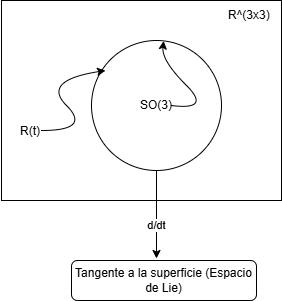
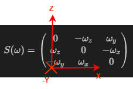
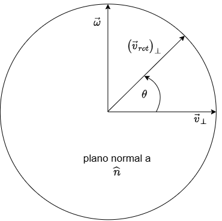
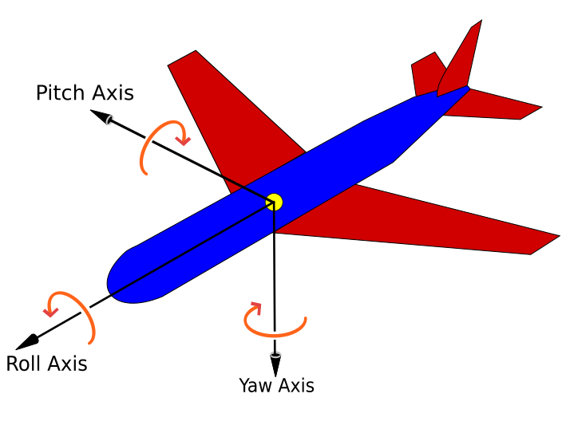

# Objetivo de este documento
Una descripción general de los conocimientos previos de robótica necesarios para derivar el modelo.

# Conocimientos previos.
## Marcos de Referencia
Un marco de referencia fijo al cuerpo (Body Frame) $S_B$ y marco de referencia Inercial (Inertial Frame) $S_I$. Las matrices de rotación que utilizamos se entienden como las usabamos en Robótica I, es decir, como matrices de cambios de coordenadas en lugar de un operador que cambia un vector en otro. Al premultiplicar un vector de coordenadas en $S_B$ como ${}^B v$ por la matriz de la transformación de $B$ a $I$, es decir $R^I_B$ obtenemos el vector ${}^I v$ o simplemente $v$.

$$\boxed{{}^Iv = R^I_B\cdot {}^Bv}$$

> <ins> Nota acerca de la medición de magnitudes </ins>: De forma general los sensores que miden velocidad del vehículo (tanto lineal como angular) se encuentran fijos a él. Luego tiene sentido que los vectores de velocidad se expresen en componentes del **Body Frame**. No estamos diciendo que la velocidad del cuerpo se mide respecto del body frame porque eso no tendría sentido álguno (siempre las velocidades serían nulas), en cambio estamos diciendo que la velocidades reales, repecto del Inertial Frame, se proyectan en ejes del body frame.

## Special Orthogonal Group of Order 3
Es el conjunto de las matrices de rotación de $\R^{3\times3}$ y se denota como $ SO(3)$. A continuación se detalla cada una de esas condiciones (grupo, especialidad y unitariedad).

### Group
---
Un grupo se define a partir de un conjunto y de una operación definida sobre ese conjunto : $$(SO(3), \cdot)$$
Sean $R$, $R_1$ y $R_2$ y $R_3$ $\epsilon\, SO(3)$, se cumplen las siguientes condiciones, que son las condiciones de grupo:

* Cerradura: $$R_1\cdot R_2 \, \epsilon \,SO(3)$$
* Elemento neutro: $$R\,\cdot \,I = R$$
* Elemento inverso: $$R\,\cdot\,R^{-1}\,=I$$
* Asociatividad: $$R_1\,\cdot(R_2\,\cdot\,R_3) = (R_1\,\cdot R_2)\,\cdot\,R_3$$

### Special
---
$$det(R) = 1$$

### Orthogonal
---
Las matrices del grupo son ortogonales.
$$R^{-1}=R^T$$

### Análisis
---
Dadas esas condiciones, los elementos del grupo tienen solamente 3 componentes libres. El grupo es **curvo, continuo y suave (es una variedad diferenciable)**. El espacio tangente en la identidad del grupo define un **Álgebra de Lie** $so(3)$ (en minúscula). Es importante dado que de acá se relaciona la velocidad angular $\omega$.

  

### Álgebra de Lie
---
Es simplemente el conjunto de las matrices anti-simétricas (en inglés skew-symmetric) y es un espacio vectorial en sí mismo
$$\mathfrak{so}(3) =SS(3) = \{ S \mid S^T = -S \}$$

Cada matriz de este espacio se puede formar a partir de las componentes de un vector $\omega\,\epsilon\,\R^3$ como:
$$ S(\omega) = \begin{pmatrix} 0 & -\omega_z & \omega_y \\ \omega_z & 0 & -\omega_x \\ -\omega_y & \omega_x & 0 \end{pmatrix}$$

*Se entiende que ese vector $\omega$ representa la velocidad angular instantánea.*

> Una regla mnemotécnica para armar la misma a partir de las componentes de un vector es fijarse en los elementos debajo de la diágonal principal. Tratas de imaginarte un sistema de referencia dextrogiro que tiene origen en el elemento $ i=3\, ,j=1$, entonces el eje $X$ queda en la dirección de la fila 3 desde izq. a der. El eje $Z$ a lo largo de la columna 1 de abajo hacia arriba y por lo tanto el eje $Y$ se mete en el papel (por eso aparece con signo menos -).
> 

>  
>

Al armar la matriz de esta forma se tiene la propiedad de que, sea $v\,\epsilon\, \R^3$:

$$\boxed{S(\omega)\cdot v = \omega \times v }$$

Por eso es:

$$S(\omega):= [\omega]_\times$$

> Lo importante del espacio de Lie es que sus elementos, que representan rotaciones infinitesimales, son generadores del grupo de rotaciones a través de la operación de exponenciación como se verá a continuación

#### Relación con la velocidad angular
---

Partiendo de la condición de ortogonalidad:

$$R \cdot R^T = I$$

Aplicar la derivada respecto al tiempo a ambos miembros:

$$\dot{R} \cdot R^T + R \cdot \dot{R}^T = 0$$

$$\dot{R} \cdot R^T + (\dot{R} \cdot R^T)^T = 0$$

$$\dot{R} \cdot R^T = -(\dot{R} \cdot R^T)^T$$

$$\dot{R} \cdot R^T \, \epsilon\,\, SS(3) \implies \dot{R} \cdot R^T:=S(\omega)$$

Al postmultiplicar a ambos lados por $R $ obtenemos:

$$
\begin{equation}
\boxed{\dot{R} := S(\omega)\cdot R}
\end{equation}
$$
> Nota: Acá la $\omega$ está en el codominio de la transformación $R$. Como generalmente $R$ va desde *Body_frame* a *Inertial_frame*, será ${}^I\omega$. Ver la [sección](#relación-angular-entre-marcos) a continuación para ver la justificación.

Qué, por analogía con los [sistemas lineales](#sistemas-lineales), se puede resolver como:
$$
\begin{equation}
\boxed{R(t) = e^{[\omega]_\times t} \cdot R(0)}
\end{equation}
$$
**<u>Esto solamente cuando la velocidad angular $\vec{\omega}$ permanece constante</u>**. Si en cambio $\vec{\omega}$ cambia en magnitud o dirección, la relación deja de ser válida. A lo sumo se puede utilizar para cambios incremetales infinitesimales de orientación en un $dt$.\
La exponencial transforma la suma del álgebra en multiplicación en el grupo: $\left(e^{A} \cdot e^{B} \approx e^{A+B}\right) $. Acá podríamos querer calcular la rotación en $t + dt$ (suma) y por lo tanto la exponencial transformaría esa suma en la multilpicación de las rotaciones en $t$ y la rotación incremental en $dt$

> #### Sistemas Lineales
> ---
>Para sistemas lineales teníamos
>$$\dot{x} = A \cdot x$$
>Que tiene solución en el tiempo:
>$$x(t) = e^{A \cdot t}\cdot x(0)$$
>Donde recordamos que:
>$$e^A = I + A + \frac{A^2}{2!} + \frac{A^3}{3!} + \dots$$
>#### Relación angular entre marcos
>---
> ${}^Br$ es un vector fijo en el *Body Frame*.
> 
> $${}^Ir = R \cdot {}^Br$$
> 
> $$\frac{d{}^Ir}{dt} = \dot{R} \cdot {}^Br + R \cdot \cancel{\frac{d{}^Br}{dt}}^{0}$$
> 
> Por la física tenemos que:
> 
> $$\frac{d{}^Ir}{dt} = {}^I\omega \times {}^Ir = [{}^I\omega]_\times {}^Ir = [{}^I\omega]_\times R \cdot {}^Br = S(\omega)\cdot R{}^B\cdot r$$
> 
> Luego, reemplazando en la ecuación original:
> 
> $$\underline{S(\omega)\cdot R} \cdot {}^Br = \underline{\dot{R}} \cdot {}^Br$$
> 
> La igualdad que se forma entre los términos subrayados es lo que se indica en la ecuación $(1)$ y por lo tanto tenemos que:
> 
> $$\omega \equiv {}^I\omega$$
> 
> Ahora queremos descubrir la relación con la velocidad angular cuando se expresa en el *body frame*. Para eso hacemos:
> 
> $$\dot{R} = S({}^I\omega) R$$
> 
> Dado que ${}^I\omega = R \cdot {}^B\omega$, queremos desarrollar $S({}^I\omega) = S(R \cdot {}^B\omega)$.
> 
> Sea $C \in \mathbb{R}^3$:
> 
> $$S(R \cdot {}^B\omega) C = [R \cdot {}^B\omega]_\times C =$$
> 
> $$= (R \cdot {}^B\omega) \times (R R^T C) = (R \cdot {}^B\omega) \times (R \cdot (R^T C)) =$$
> 
> $$= R \cdot ({}^B\omega \times R^T C) = R [{}^B\omega]_\times R^T C$$
> En donde se ha utilizado una [propiedad de la rotación de un producto vectorial](#propiedad-de-la-rotación-del-producto-vectorial-de-vectores). Luego igualando con la expresión original tenemos:
> $$S(R \cdot {}^B\omega) C = R S({}^B\omega) R^T C$$
> Cómo el vector $C$ es arbitrario tenemos que:
> $$\implies \boxed{S(R \cdot {}^B\omega) = R S({}^B\omega) R^T}$$
> 
> A continuación reemplazamos esta relación en la ecuación $(1)$ tomando en cuenta que la velocidad angular que allí se indica es la velocidad angular en coordenadas del marco inercial:
> 
> $$\dot{R} = S({}^I\omega) R$$
> 
> $$\dot{R} = S(R \cdot {}^B\omega) R$$
> 
> $$\dot{R} = R S({}^B\omega) R^T R$$
> 
> $$\boxed{\dot{R} = R S({}^B\omega)}$$
> ***La conclusión es que con $R$ a la izquierda, la velocidad angular está en el marco de referencia del body mientras que con $R$ a la derecha, la velocidad angular está en el frame inercial.***
>#### Propiedad de la Rotación del Producto Vectorial de Vectores
>---
>Sean $\mathbf{u}, \mathbf{v} \in \mathbb{R}^3$ y sea $R \in SO(3)$. Queremos comprobar la identidad:
>$$R(\mathbf{u} \times \mathbf{v}) = R\mathbf{u} \times R\mathbf{v}$$
> Para demostrarlo, introducimos un vector arbitrario de prueba $\mathbf{w} \in \mathbb{R}^3$ y analizamos su producto escalar con el término de la izquierda:
> 
> $$\mathbf{w} \cdot R(\mathbf{u} \times \mathbf{v}) = \mathbf{w}^T R (\mathbf{u} \times \mathbf{v})$$
> $$\mathbf{w}^T (R^T)^T (\mathbf{u} \times \mathbf{v}) = (R^T \mathbf{w})^T (\mathbf{u} \times \mathbf{v})$$
> 
> Interpretando ese producto matricial a través del producto escalar, la transpuesta del paréntesis izquierdo la podemos eliminar y tenemos:
> $$(R^T \mathbf{w}) \cdot (\mathbf{u} \times \mathbf{v})$$
> 
> Haciendo uso de la identidad del producto mixto: $\mathbf{a} \cdot (\mathbf{b} \times \mathbf{c}) = \det([\mathbf{a} \mid \mathbf{b} \mid \mathbf{c}])$
> 
> $$(R^T \mathbf{w}) \cdot (\mathbf{u} \times \mathbf{v}) = \det \left( R^T \mathbf{w} \;\middle|\; \mathbf{u} \;\middle|\; \mathbf{v} \right)$$
> $$= \det \left( R^T \mathbf{w} \;\middle|\; R^T R \mathbf{u} \;\middle|\; R^T R \mathbf{v} \right)$$
> $$= \det \left( R^T \left[ \mathbf{w} \;\middle|\; R\mathbf{u} \;\middle|\; R\mathbf{v} \right] \right)$$
> $$= \det(R^T) \cdot \det \left( \mathbf{w} \;\middle|\; R\mathbf{u} \;\middle|\; R\mathbf{v} \right)$$
> 
> 
> $$= 1 \cdot \det \left( \mathbf{w} \;\middle|\; R\mathbf{u} \;\middle|\; R\mathbf{v} \right) = \mathbf{w} \cdot (R\mathbf{u} \times R\mathbf{v})$$
> 
> Comparando el inicio y el final de la cadena de igualdades para cualquier vector $\mathbf{w}$:
> 
> $$\mathbf{w} \cdot R(\mathbf{u} \times \mathbf{v}) = \mathbf{w} \cdot (R\mathbf{u} \times R\mathbf{v})$$
> 
> Dado que la relación es válida para todo vector $\mathbf{w}$, los vectores deben ser idénticos:
> 
> $$\boxed{R(\mathbf{u} \times \mathbf{v}) = R\mathbf{u} \times R\mathbf{v}}$$
> ***La rotación de un producto vectorial es equivalente al producto vectorial de los vectores rotados.***

## Fórmula de Rodrigues

$$
\begin{equation}
\boxed{R = I + \sin(\theta)[\hat{n}]_\times + (1 - \cos(\theta))\cdot [\hat{n}]_\times^2}
\end{equation}
$$
En donde:
*  $\mathbf{\hat{n}}$ es el eje unitario de rotación
*  $\mathbf{\theta}$ es la magnitud de la rotación
*  ${[\hat{n}]_\times^2 = [\hat{n}]_\times \cdot [\hat{n}]_\times = \hat{n} \cdot \hat{n}^T - I}$[*](#doble-producto-vectorial)

Es una forma alternativa de la ecuación (2) pero sin la necesidad de utilizar los infinitos términos de la exponencial. Se basa en el teorema de Euler de las rotaciones que dice así.

> **Teorema de Euler para las rotaciones**: Cualquier sucesión de rotaciones de un cuerpo rígido equivale a una única rotación definida por un eje y un ángulo.

Aplicando la identidad del seno y del coseno del ángulo doble se obtiene una forma alternativa de expresar la fórmula de Rodrigues que nos va a servir para después:
$$
\begin{equation}
\boxed{R = I + 2\cos(\theta/2)sin(\theta/2)[\hat{n}]_\times + 2\sin^2(\theta/2)\cdot [\hat{n}]_\times^2}
\end{equation}$$
>### Doble producto vectorial
>---
>$$[\hat{n}]_\times^2 = \begin{pmatrix} 0 & -n_z & n_y \\ n_z & 0 & -n_x \\ -n_y & n_x & 0 \end{pmatrix} \begin{pmatrix} 0 & -n_z & n_y \\ n_z & 0 & -n_x \\ -n_y & n_x & 0 \end{pmatrix} =  \begin{pmatrix} -n_z^2 - n_y^2 & n_x n_y & n_x n_z \\ n_x n_y & -n_z^2 - n_x^2 & n_y n_z \\ n_x n_z & n_y n_z & -n_y^2 - n_x^2 \end{pmatrix}$$
>Como $\hat{n}$ es un vector unitario, se cumple que $n_x^2 + n_y^2 + n_z^2 = 1$. Sustituyendo los términos de la diagonal (ej. $-n_z^2 - n_y^2 = n_x^2 - 1$):
>$$[\hat{n}]_\times^2 = \begin{pmatrix} n_x^2 - 1 & n_x n_y & n_x n_z \\ n_x n_y & n_y^2 - 1 & n_y n_z \\ n_x n_z & n_y n_z & n_z^2 - 1 \end{pmatrix} =  \hat{n} \cdot \hat{n}^T - I$$
>A partir de la relación anterior es que se obtiene la fórmula de Rodrigues desde la exponencial $e^{[\omega]_\times\cdot t}$ dado que hace que sea $[\hat{n}]_\times^3 = -[\hat{n}]_\times$ y así sucesivamente. Esta relación del producto doble de matrices de producto vectorial se puede obtener a partir de la [identidad del producto exterior](#identidad-del-producto-exterior). La deducción consiste en desarrollar el producto vectorial doble $\hat{n}\times(\hat{n}\times c)$, donde $c$ es un vector arbitrario. La propiedad del producto exterior se aplica sobre el primer término (el positivo), luego se agrupa sacando factor común dicho vector arbitrario. Esto es análogo a lo que se aplica cuando se tiene el integrando para los [tensores de inercia](#relación-de-tensores), salvo que acá, como $\hat{n}$ es unitario el resultado del término $\hat{n}^2I$ es igual $I$.
> ### Deducción geométrica de la fórmula de Rodrigues
> ---
> El vector $\vec{v}$ se separa en dos componentes respecto al eje  unitario $\hat{n}$: una componente paralela a $\hat{n}$ (que permanece invariante durante la rotación) y una componente perpendicular (que rota sobre el plano normal a $\hat{n}$). Finalmente, se combinan ambas componentes tras la rotación para reconstruir la fórmula.
> 
> El vector $\vec{v}$ se descompone en sus componentes paralela ($\vec{v}_\parallel$) y perpendicular ($\vec{v}_\perp$) al eje $\hat{n}$:
> 
> $$\vec{v}_\parallel = (\hat{n} \cdot \vec{v})\hat{n}$$
> 
> $$\vec{v}_\perp = \vec{v} - \vec{v}_\parallel = \vec{v} - (\hat{n} \cdot \vec{v})\hat{n}$$
> 
> Donde $\vec{v}_\parallel$ es la proyección ortogonal de $\vec{v}$ sobre el eje de rotación y $\vec{v}_\perp$ es el vector remanente contenido en el plano de rotación.
> 
> Para describir la rotación dentro del plano perpendicular, se define un  segundo vector $\vec{w}$ que es ortogonal tanto a $\hat{n}$ como a $\vec{v}_\perp$:
> 
> $$\vec{w} = \hat{n} \times \vec{v}$$
> 
> Dado que $\hat{n} \times \vec{v}_\parallel = 0$, se verifica que $\hat{n} \times \vec{v} = \hat{n} \times \vec{v}_\perp$. Debido a que $\|\hat {n}\| = 1$ y $\hat{n} \perp \vec{v}_\perp$, la magnitud de $\vec{w}$ es  idéntica a la de $\vec{v}_\perp$:
> 
> $$\|\vec{w}\| = \|\hat{n}\| \|\vec{v}_\perp\| \sin(90^\circ) = \|\vec{v}_\perp\|$$
> 
> Por lo tanto, el conjunto $\{\vec{v}_\perp, \vec{w}\}$ constituye una base ortogonal para el plano de rotación.
> 
> 
> Aplicando una transformación de rotación bidimensional estándar en la base del plano, el vector perpendicular rotado ($\vec{v}_{\perp,\text{rot}}$) se expresa como:
> 
> $$\vec{v}_{\text{rot},\perp} = \cos(\theta)\vec{v}_\perp + \sin(\theta) \vec{w}$$
> 
> 

>   
> 

> 
> Sustituyendo las expresiones previas:
> 
> $$\vec{v}_{\perp,\text{rot}} = \cos(\theta)\vec{v}_\perp + \sin(\theta)(\hat{n} \times \vec{v})$$
> 
> El vector rotado final $\vec{v}_{\text{rot}}$ se obtiene sumando la  componente paralela inalterada y la componente perpendicular rotada:
> 
> $$\vec{v}_{\text{rot}} = \vec{v}_\parallel + \vec{v}_{\perp,\text{rot}} $$
> 
> $$\vec{v}_{\text{rot}} = \vec{v}_\parallel + \cos(\theta)(\vec{v} - \vec{v}_\parallel) + \sin(\theta)(\hat{n} \times \vec{v})$$
> 
> Agrupando los términos en función de $\vec{v}$ y $\vec{v}_\parallel$:
> 
> $$\vec{v}_{\text{rot}} = \cos(\theta)\vec{v} + (1 - \cos(\theta))\vec{v}_\parallel + \sin(\theta)(\hat{n} \times \vec{v})$$
> 
> Sustituyendo formalmente $\vec{v}_\parallel = (\hat{n} \cdot \vec{v}) \hat{n}$, se llega a la forma vectorial de la ecuación de Rodrigues:
> 
> $$\vec{v}_{\text{rot}} = \cos(\theta)\vec{v} + (1 - \cos(\theta))(\hat{n} \cdot \vec{v})\hat{n} + \sin(\theta)(\hat{n} \times \vec{v})$$
> 
> Para transformar la ecuación vectorial en una operación matriz-vector, se emplean las siguientes identidades algebraicas:
> 
> 1. **Matriz de producto cruz:** $\hat{n} \times \vec{v} = [\hat{n}]_\times \vec{v}$
> 2. **Producto exterior:** $(\hat{n} \cdot \vec{v})\hat{n} = (\hat{n}\hat{n}^T)\vec{v}$. [*](#identidad-del-producto-exterior)
> 3. **Identidad geométrica previamente demostrada:** $\hat{n}\hat{n}^T = [\hat{n}]_\times^2 + \mathbf{I}$
> 
> Sustituyendo estas relaciones en la ecuación del paso anterior:
> 
> $$\vec{v}_{\text{rot}} = \cos(\theta)\mathbf{I}\vec{v} + (1 - \cos(\theta))([\hat{n}]_\times^2 + \mathbf{I})\vec{v} + \sin(\theta)[\hat{n}]_\times \vec{v}$$
> 
> Factorizando el vector $\vec{v}$ a la derecha:
> 
> $$\vec{v}_{\text{rot}} = \left[ \cos(\theta)\mathbf{I} + (1 - \cos(\theta))\mathbf{I} + \sin(\theta)[\hat{n}]_\times + (1 - \cos(\theta))[\hat{n}]_\times^2 \right] \vec{v}$$
> 
> Simplificando los términos de la matriz identidad ($\cos(\theta) + 1 - \cos(\theta) = 1$):
> 
> $$\vec{v}_{\text{rot}} = \left[ \mathbf{I} + \sin(\theta)[\hat{n}]_\times + (1 - \cos(\theta))[\hat{n}]_\times^2 \right] \vec{v}$$
> 
> 
> La **Matriz de Rotación $R$** obtenida mediante el desarrollo puramente geométrico es:
> 
> $$\boxed{R = \mathbf{I} + \sin(\theta)[\hat{n}]_\times + (1 - \cos(\theta))[\hat{n}]_\times^2}$$
> #### Identidad del Producto exterior
>---
>$$(\hat{n} \cdot \vec{v})\hat{n} = ((\hat{n} \cdot \vec{v})\hat{n}^T)^T =  ((\vec{v}^T\cdot\hat{n})\hat{n}^T)^T = (\vec{v}^T\cdot\hat{n}\cdot\hat{n}^T)^T = \hat{n} \cdot \hat{n}^T\cdot \vec{v} = (\hat{n} \cdot \hat{n}^T) \vec{v} $$

## Special Unitary Group of order 2

$SU(2)$ es el conjunto de las matrices de $\mathbb{C}^{2\times2}$ que cumplen con las siguientes condiciones.

### Special
---
$$U \cdot U^\dagger = I$$

En donde la daga indica la traspuesta conjugada a diferencia de las matrices de rotación reales.

### Unitary
---
$$\det(U) = 1$$

### Group
---
Cumple con las condiciones indicadas acerca de los grupos. Es decir, que es cerrado respecto de la multiplicación de matrices, es asociativo, existe elemento neutro y elemento inverso.

### Análisis
---
Si el conjunto fuera completamente libre sería de dimensión 8 (dos componentes de cada uno de los 4 números complejos de la matriz). Sin embargo las restricciones indicadas dejan el grupo solamente en 3 dimensiones y los elementos del grupo son de la forma.

$$\boxed{U = \begin{pmatrix} a & b \\ -\bar{b} & \bar{a} \end{pmatrix} \quad \text{con } a,b \in \mathbb{C}, \quad \vert{}a\vert{}^2 + \vert{}b\vert{}^2 = 1}$$

Estos elementos corresponden a los puntos de la esfera de radio unitario $S^3$ embedida en $\R^4$ (que corresponde a los cuatro números reales que parametrizan los dos números complejos $a$ y $b$).
> La dimensión de la esfera viene dada por el número de parámetros reales libres. En este caso son las dos componentes de un complejo + una componente del otro, dado que la restricción de norma acota la otra componente.

## Cuaterniones
Los elementos de un cuaternión unitario se expresan en forma vectorial con las componentes (**parámetros de Euler**):
$$
\begin{equation}
\boxed{(\eta, \epsilon_1, \epsilon_2, \epsilon_3) \, \epsilon\, \R}
\end{equation}
$$
Según:
$$q = \begin{bmatrix} \eta & \vec{\epsilon}^T \end{bmatrix}^T = \begin{bmatrix} \eta & \epsilon_1 & \epsilon_2 & \epsilon_3 \end{bmatrix}^T$$

* $\eta$ : parte real
* $\vec{\epsilon}$ : parte imaginaria (vectorial)

Son unitarios porque cumplen:
$$\boxed{ \eta^2 + \epsilon_1^2 + \epsilon_2^2 + \epsilon_3^2 = 1}$$

### Acerca de los cuaterniones
---
Las componentes de la parte imaginaria van con las unidades $i, j, k$ y se cumplen las siguientes propiedades del producto entre estas unidades imaginarias:
$$\boxed{i^2 = j^2 = k^2 = ijk = -1}$$
$$\boxed{ij = k, \quad jk = i, \quad ki = j}$$
$$\boxed{ji = -k, \quad kj = -i, \quad ik = -j}$$

Estas dos últimas propiedades son las mismas que las del producto vectorial de los versores de un marco de referencia 3-dimensional dextrógiro.

### Producto de cuaterniones
---
> El símbolo $\otimes$ se usa para indicar la multiplicación de cuaterniones.

El producto de cuaterniones *se desarrolla de la misma manera que se desarrolla el producto de números complejos*, con la salvedad de que en este caso serían 3 componentes imaginarias y de que hay que respetar las identidades indicadas del producto entre unidades imaginarias.

> El producto **no es conmutativo** pero **sí es asociativo**

Sean dos cuaterniones unitarios $a$ y $b$ definidos como:
$$a = [\eta_a, \mathbf{a}] = \eta_a + a_x\mathbf{i} + a_y\mathbf{j} + a_z\mathbf{k}$$
$$b = [\eta_b, \mathbf{b}] = \eta_b + b_x\mathbf{i} + b_y\mathbf{j} + b_z\mathbf{k}$$

$$c = (\eta_a + a_x\mathbf{i} + a_y\mathbf{j} + a_z\mathbf{k}) \otimes (\eta_b + b_x\mathbf{i} + b_y\mathbf{j} + b_z\mathbf{k})$$

Agrupando en parte real e imaginaria:
$$c_{\text{real}} = \eta_a \eta_b - a_x b_x - a_y b_y - a_z b_z = \eta_a \eta_b - \mathbf{a} \cdot \mathbf{b}$$
$$c_{\text{imag}} = (\eta_a b_x + \eta_b a_x + a_y b_z - a_z b_y)\mathbf{i} + (\eta_a b_y + \eta_b a_y + a_z b_x - a_x b_z)\mathbf{j} + (\eta_a b_z + \eta_b a_z + a_x b_y - a_y b_x)\mathbf{k}$$

Expresado de forma compacta utilizando el producto escalar ($\cdot$) y el producto vectorial ($\times$):
$$c = a \otimes b = [\eta_a \eta_b - \mathbf{a} \cdot \mathbf{b}, \eta_a \mathbf{b} + \eta_b \mathbf{a} + \mathbf{a} \times \mathbf{b}]$$

Que se expresa de forma matricial de la siguiente manera:
$$\begin{bmatrix} \eta_c \\ c_x \\ c_y \\ c_z \end{bmatrix} = \begin{bmatrix} \eta_a & -a_x & -a_y & -a_z \\ a_x & \eta_a & -a_z & a_y \\ a_y & a_z & \eta_a & -a_x \\ a_z & -a_y & a_x & \eta_a \end{bmatrix} \begin{bmatrix} \eta_b \\ b_x \\ b_y \\ b_z \end{bmatrix}$$

En donde se utilizó la matriz $S(\mathbf{a})$ o $[\mathbf{a}]_\times$ para expresar el producto vectorial.

$$
\begin{equation}
  \boxed{\mathbf{a}\otimes\mathbf{b} = \begin{bmatrix} \eta_a & -\mathbf{a}^T \\ \mathbf{a} & \eta_a \mathbf{I}_3 + [\mathbf{a}]_\times \end{bmatrix} \begin{bmatrix} \eta_b \\ \mathbf{b} \end{bmatrix}}
\end{equation}
$$
> Donde, el elemento $(2,2)$ en esta forma agregada se sintetiza en la siguiente notación
> $$U(a) = \eta_a I_3 + [\mathbf{a}]_x$$

### Conjugado de un cuaterion
---
El conjugado de un cuaterion $a = [\eta_a, \mathbf{a}] = \eta_a + a_x\mathbf{i} + a_y\mathbf{j} + a_z\mathbf{k}$ se simboliza $a^*$ y es:
$$\boxed{a^* = [\eta_a, -\mathbf{a}] = \eta_a - a_x\mathbf{i} - a_y\mathbf{j} - a_z\mathbf{k}}$$

### Propiedad del conjugado del producto de cuaterniones
---

Sean dos cuaterniones cualesquiera $a = [\eta_a, \mathbf{a}]$ y $b = [\eta_b, \mathbf{b}]$. Se desea demostrar que el conjugado de su producto es igual al producto de sus conjugados en orden inverso:

$$(a \otimes b)^* = b^* \otimes a^*$$

Utilizando la definición del producto de cuaterniones, el producto $c = a \otimes b$ es:

$$a \otimes b = [\eta_a \eta_b - \mathbf{a} \cdot \mathbf{b}, \;\eta_a \mathbf{b} + \eta_b \mathbf{a} + \mathbf{a} \times \mathbf{b}]$$

$$(a \otimes b)^* = [\eta_a \eta_b - \mathbf{a} \cdot \mathbf{b}, \; -(\eta_a \mathbf{b} + \eta_b \mathbf{a} + \mathbf{a} \times \mathbf{b})]$$

$$(a \otimes b)^* = [\eta_a \eta_b - \mathbf{a} \cdot \mathbf{b}, \; -\eta_a \mathbf{b} - \eta_b \mathbf{a} - \mathbf{a} \times \mathbf{b}]$$

$$b^* \otimes a^* = [ \eta_b \eta_a - (-\mathbf{b}) \cdot (-\mathbf{a}), \; \eta_b (-\mathbf{a}) + \eta_a (-\mathbf{b}) + (-\mathbf{b}) \times (-\mathbf{a}) ]$$

$$\boxed{(a \otimes b)^* = b^* \otimes a^*}$$

## Relación entre SU(2), los cuaterniones unitarios y SO(3) (Rotaciones)

### ISOMORFISMO
---
Existe una relación de **isomorfismo** entre los cuaterniones unitarios **$q$** y $SU(2)$, es decir que son básicamente el mismo grupo o bien se establece una correspondiencia uno a uno entre los elementos de los dos conjuntos. Y la relación entre las componentes viene dada por:
$$\eta \leftrightarrow a_1$$
$$\epsilon_3 \leftrightarrow a_2$$
$$\epsilon_2 \leftrightarrow b_1$$
$$\epsilon_1 \leftrightarrow b_2$$

### HOMOMORFISMO
---

> La relación de homomorfismo entre dos grupos $(G, \ast)$ y $(H, \cdot)$ mediante una función $f: G \to H$ se define formalmente como:
> $$f(x \ast y) = f(x) \cdot f(y) \quad \forall \, x, y \in G$$
>Esta propiedad significa que **la estructura algebraica se preserva a través de la función**.\
Y se cumplen estas propiedades:
>* Preservación de la identidad: $f(e_G) = e_H$
>* Preservación de inversos: $f(a^{-1}) = [f(a)]^{-1}$

Existe una relación de **homomorfismo** $SU(2)$ (o $q$) y $SO(3)$ que es de **doble cobertura** $(2:1)$. Esto quiere decir que a cada elemento de $SO(3)$ le corresponden exactamente 2 elementos de $q$ o $SU(2)$.

Formalmente, la función $f: SU(2) \to SO(3)$ preserva la operación del grupo:
$$\boxed{f(q_1 \otimes q_2) = f(q_1) \cdot f(q_2)}$$
Y esa función es simplemente la que mapea de cuateriones o matrices de $SU(2)$ a matrices del grupo de rotaciones.

### Mapeo explícito

Si expresamos el cuaternión unitario a partir de un ángulo de rotación $\theta$ alrededor de un eje unitario $\hat{n}$:

$$\boxed{q = \cos\left(\frac{\theta}{2}\right) + \sin\left(\frac{\theta}{2}\right)\hat{n} }$$

Luego en relación a los parámetros de Euler de los cuaterniones visto en la ecuación $(4)$ tenemos:

$$\boxed{\eta = \cos\left(\frac{\theta}{2}\right)} \quad \boxed{\epsilon = \sin\left(\frac{\theta}{2}\right)\hat{n} }$$

La matriz de rotación correspondiente $R \in SO(3)$ se obtiene aplicando la fórmula de Rodrigues siguiendo lo expresado en la ecuación $(4)$:

$$
\begin{equation}
R = I + 2\eta[\hat{\epsilon}]_\times + 2[\hat{\epsilon}]_\times^2
\end{equation}
$$

> Donde se observa claramente que si cambiás $q$ por $-q$ (es decir, $\eta \to -\eta$ y $\hat{n} \to -\hat{n}$), el signo negativo se cancela en el desarrollo algebraico y produce exactamente la misma matriz $R$ (doble cobertura). De todas maneras esto es algo intuitivo porque estamos inviertiendo el eje y también el ángulo de giro, al invertir dos cosas todo queda igual y es la misma rotación.

### Rotación mediante $q \otimes v \otimes q^*$
---
La fórmula en $(7)$ se puede también obtener de la siguiente forma.
Para rotar un vector tridimensional $\vec{v}$, este se expresa como un cuaternión puro $v = [0, \vec{v}]$. La operación de rotación está dada por el producto de cuaterniones $q \otimes v \otimes q^*$, donde $q = [\eta, \vec{\epsilon}]$ es el cuaternión unitario asociado a la rotación.

$$q \otimes v = \begin{bmatrix} \eta & -\vec{\epsilon}^T \\ \vec{\epsilon} & \eta \mathbf{I} + [\vec{\epsilon}]_\times \end{bmatrix} \begin{bmatrix} 0 \\ \vec{v} \end{bmatrix} = \begin{bmatrix} -\vec{\epsilon} \cdot \vec{v} \\ \eta\vec{v} + \vec{\epsilon} \times \vec{v} \end{bmatrix}$$

Multiplicando el resultado anterior por el cuaternión conjugado $q^* = [\eta, -\vec{\epsilon}]$ en forma matricial por derecha:

$$q \otimes v \otimes q^* = \begin{bmatrix} -\vec{\epsilon} \cdot \vec{v} & -(\eta\vec{v} + \vec{\epsilon} \times \vec{v})^T \\ \eta\vec{v} + \vec{\epsilon} \times \vec{v} & -(\vec{\epsilon} \cdot \vec{v})\mathbf{I} + [\eta\vec{v} + \vec{\epsilon} \times \vec{v}]_\times \end{bmatrix} \begin{bmatrix} \eta \\ -\vec{\epsilon} \end{bmatrix}$$

Desarrollando los términos para la parte real (primer elemento) y la parte vectorial (segundo elemento):

$$= \begin{bmatrix} -\eta(\vec{\epsilon} \cdot \vec{v}) + (\eta\vec{v} + \vec{\epsilon} \times \vec{v})^T \cdot \vec{\epsilon} \\ \eta(\eta\vec{v} + \vec{\epsilon} \times \vec{v}) + (\vec{\epsilon} \cdot \vec{v})\vec{\epsilon} - [\eta\vec{v} + \vec{\epsilon} \times \vec{v}]_\times \vec{\epsilon} \end{bmatrix}$$

Dado que $(\vec{\epsilon} \times \vec{v}) \cdot \vec{\epsilon} = 0$ y hay una suma de términos opuestos, la parte real se anula, resultando en un cuaternión puro cuya parte imaginaria es:

$$ \eta^2\vec{v} + \eta(\vec{\epsilon} \times \vec{v}) + (\vec{\epsilon} \cdot \vec{v})\vec{\epsilon} - \eta(\vec{v} \times \vec{\epsilon}) - (\vec{\epsilon} \times \vec{v}) \times \vec{\epsilon}$$

Sabiendo que $- \eta(\vec{v} \times \vec{\epsilon}) = \eta(\vec{\epsilon} \times \vec{v})$ y que  $-(\vec{\epsilon} \times \vec{v}) \times \vec{\epsilon} = \vec{\epsilon} \times (\vec{\epsilon} \times \vec{v})$:

$$\eta^2\vec{v} + 2\eta(\vec{\epsilon} \times \vec{v}) + (\vec{\epsilon} \cdot \vec{v})\vec{\epsilon} + \vec{\epsilon} \times (\vec{\epsilon} \times \vec{v})$$

Sumamos y restamos el término $\vec{\epsilon}^2\vec{v}$:

$$\eta^2\vec{v} + \vec{\epsilon}^2\vec{v} + 2\eta(\vec{\epsilon} \times \vec{v}) + (\vec{\epsilon} \cdot \vec{v})\vec{\epsilon} - \vec{\epsilon}^2\vec{v} + \vec{\epsilon} \times (\vec{\epsilon} \times \vec{v}) $$

Usamos la identidad: $\vec{\epsilon} \times (\vec{\epsilon} \times \vec{v}) = (\vec{\epsilon} \cdot \vec{v})\vec{\epsilon} - \vec{\epsilon}^2\vec{v}$

$$(\eta^2 + \vec{\epsilon}^2)\vec{v} + 2\eta(\vec{\epsilon} \times \vec{v}) + \vec{\epsilon} \times (\vec{\epsilon} \times \vec{v}) + \vec{\epsilon} \times (\vec{\epsilon} \times \vec{v})$$

Dado que el cuaternión es unitario, se cumple que $\eta^2 + \vec{\epsilon}^2 = 1$

$$\vec{v} + 2\eta(\vec{\epsilon} \times \vec{v}) + 2\vec{\epsilon} \times (\vec{\epsilon} \times \vec{v})$$

Luego en forma matricial queda:
$$\mathbf{R}\vec{v} = \left( \mathbf{I} + 2\eta[\vec{\epsilon}]_\times + 2[\vec{\epsilon}]_\times^2 \right) \vec{v}$$

Por lo tanto, la **Matriz de Rotación $R$** queda definida como:

$$\boxed{R = \mathbf{I} + 2\eta[\vec{\epsilon}]_\times + 2[\vec{\epsilon}]_\times^2}$$

Que es la misma fórmula de Rodrigues.

### Composición de rotaciones con cuaterniones
---
Aplicamos una rotación inicial dada por $q_1$ y luego otra rotación dada por $q_2$ sobre un vector $\vec{v}$. Esto es
$$q_2\otimes(q_1\otimes \vec{v} \otimes q_1^*)\otimes q_2^*$$
Dado que el producto de cuaterniones es asociativo esto es:
$$(q_2\otimes q_1)\otimes \vec{v} \otimes (q_1^* \otimes q_2^*)$$
Y por la propiedad del conjugado de producto de quaterniones:
$$(q_2\otimes q_1)\otimes \vec{v} \otimes (q_2 \otimes q_1)^*$$
De esto se determina que la composición de rotaciones se representa por un cuaternion que es el producto de los cuaterniones de las rotaciones individuales.
> Esta es una comprobación de la relación de homomorfismo entre los grupos. Dijimos que el producto de cuaterniones se traduce en producto de sus imagenes (producto de matrices de rotación) y dado que el producto de rotaciones es una composición de rotaciones, evidentemente el producto de los cuaterniones correspondientes representa por lo tanto la misma rotación.

### Rotación inversa
---
Siguiendo la ecuación $(7)$ la inversa se obtiene haciendo la traspuesta a ambos lados:
$$ R^{-1} = R^T = \mathbf{I}^T + 2\eta[\boldsymbol{\epsilon}]_\times^T + 2\left([\boldsymbol{\epsilon}]_\times^2\right)^T $$

Utilizando las siguientes propiedades de las matrices:
$$ (M^n)^T = (M^T)^n $$
$$[\boldsymbol{\epsilon}]_\times^T = -[\boldsymbol{\epsilon}]_\times$$

Obtenemos:
$$R^{-1} = \mathbf{I} + 2\eta(-[\boldsymbol{\epsilon}]_\times) + 2(-[\boldsymbol{\epsilon}]_\times)^2$$

Si establecemos $R(q)$ como la matriz de rotación correspondiente a un cuaterion $q$, entonces es $\boxed{R^{-1}(q) = R(q^*)}$
> Esto sería una comprobación de la propiedad de que se conserva la correspondencia entre los inversos de elementos que se relacionan entre los grupos a través del homomorfismo. Y por lo tanto se entiene que en el grupo de los cuaterniones, el inverso es el conjugado.

## Ángulos de Euler
Además de las matrices de rotación y de los cuaterniones, otra convención utilizada para representar rotaciones es la de los **Ángulos de Euler**

$$\boxed{\textbf{roll} (\phi) \quad \textbf{pitch} (\theta)\quad \textbf{yaw} (\psi)}$$

  

Se utilizan rotaciones intrínsecas, es decir, que las rotaciones sobre los ejes indicados se van aplicando sucesivamente sobre los sistemas rotados. Es decir, rotamos respecto del eje Z en el marco base, después respecto al eje Y del sistema obtenido en la rotación anterior y finalmente sobre el eje X del sistema obtenido de la rotación anterior. Si establecemos la analogía con lo que vimos para los robots serie en Robótica I, el eje de la primera articulación es la de ***yaw ($\psi$)***, la que sigue es la de ***pitch ($\theta$)*** y la última es la de ***roll ($\phi$)***. Luego, la matriz de rotación total se obtiene como:

$$R = R(z,\psi) \cdot R(y, \theta) \cdot R(x, \phi)$$

Y la transición entre sistemas es la siguiente:

$$
\begin{equation}
\boxed{S_0 (S_I) \xrightarrow{\text{yaw}} S_1 \xrightarrow{\text{pitch}} S_2 \xrightarrow{\text{roll}} S_3 (S_B)}
\end{equation}
$$

### Relación entre las rotaciones extrínsecas e intrínsecas
---

> Acá hablamos de las rotaciones intrínsecas. Las rotaciones extrínsecas son rotaciones que se aplican sucesivamente tomando como referencia los ejes del marco de referencia original. En ese sentido, *roll* se hace tomando en cuenta el eje $X_I$, *pitch* se hace tomando en cuenta $Y_I$ y *yaw* se hace tomando en cuenta el eje $Z_I$.

Vamos a interpretar por un momento a las rotaciones como operadores que transforman vectores. Es decir, que al premultiplicar un vector en un marco por la matriz de rotación, lo que obtenemos es ese vector rotado en el mismo marco de referencia. Entonces es claro que las rotaciones se deben concatenar por izquierda. Por ejemplo, si hacemos una sucesión de transformaciones $R_1$, $R_2$ y $R_3$ para transformar un vector $v$ expresado en el sistema $S_I$, primero premultiplicamos por $R_1$; eso nos da un vector transformado en el mismo $S_I$. Luego aplicamos $R_2$, que también nos da la transformación del vector en $S_I$, y finalmente aplicamos $R_3$, que nos da la transformación total. En símbolos es:

$$v_{\text{rot}} = R_3 \cdot R_2 \cdot R_1 \cdot v$$

> Para cada transformación intrínseca existe una transformación extrínseca correspondiente cuya relación vamos a demostrar a continuación.

Supongamos por el momento una sucesión de dos transformaciones intrínsecas $R_1$ y $R_2$ en ese orden. $R_1$ es una rotación definida en $S_I$ y $R_2$ es una rotación respecto del marco de referencia rotado luego de aplicar $R_1$, al que llamaremos $S_1$. Esto significa que $R_1$ espera vectores en $S_I$ y los devuelve en $S_I$, y $R_2$ espera vectores expresados en  $S_1$ y escupe vectores en el mismo marco $S_1$ (*recordemos que estamos interpretando las rotaciones como operadores que rotan vectores en un mismo marco de referencia*).

Entonces la cadena de pensamiento sería algo así: para aplicar $R_2$ sobre un vector rotado por $R_1$ (${}^Iv_{rot}$) primero, tengo que expresarlo en coordenadas de $S_1$ lo que implica interpretar momentaneamente la matriz de rotación $R_1$ como una matriz de cambio de base en lugar de un operador de rotación:

$$R_1^{-1} \cdot {}^{I}v_{\text{rot}}$$

Luego aplico la rotación $R_2$ definida en $S_1$, que queda expresada en el marco del sistema $S_1$:

$$R_2 \cdot R_1^{-1} \cdot {}^{I}v_{\text{rot}}$$

Luego, para obtener el vector rotado en el marco de referencia original $S_I$, hay que premultiplicar por $R_1$, en donde nuevamente se interpreta esta matriz como una matriz de cambio de base:

$$R_1 \cdot R_2 \cdot R_1^{-1} \cdot {}^{I}v_{\text{rot, I}}$$

Pero ${}^{I}v_{\text{rot}} = R_1 \cdot v$, luego es:

$$R_1 \cdot R_2 \cdot R_1^{-1} \cdot R_1 \cdot v = R_1 \cdot R_2 \cdot v$$

> Además, dado que $R_1$ puede condensar una secuencia de múltiples rotaciones intrínsecas. Podemos decir de forma general que **una secuencia abitraria de rotaciones intrínsecas equivale a la secuencia inversa de rotaciones extrínsecas y viceversa**.
>
> Es decir, la secuencia intrínseca *yaw*, *pitch* y *roll* es la secuencia extrínseca *roll*, *pitch* y *yaw*. Lo que se ve claramente por cómo se concatenan las matrices de rotación por izquierda.
>
> Esto es solamente para establecer cómo es el orden de las matrices. Cuando son rotaciones intrínsecas, las ordenás en el orden de las rotaciones de izquierda a derecha. Cuando son rotaciones extrínsecas, las ordenás de derecha a izquierda.

### Gimbal Lock
---
> A continuación hacemos una justificación del concepto de Gimbal Lock, que ocurre cuando se utilizan los **Ángulos de Euler** para representar orientaciones del cuerpo. Para la demostración hacemos un análisis de la velocidad ángular y cómo se relaciona con las tasas de los Ángulos de Euler

La velocidad angular que se proyecta en los ejes del *body frame* es:
$${}^B \vec{\omega} = \begin{bmatrix}p\\ q\\ r\end{bmatrix}$$

Nuestro objetivo es relacionar ese vector con las tasas instantáneas de los ángulos de Euler $\dot{\phi}, \dot{\theta}, \dot{\psi}$ cuando el cuerpo está en una orientación dada por $R(\psi, \theta, \phi)$. Para eso debemos componerlas sumando, lo que se puede dado que son tasas instantáneas en lugar de rotaciones finitas.

Siguiendo la relación establecida en $(8)$, vemos que las respectivas tasas tienen sentido solamente en los marcos donde se definen y deben aplicarse sobre esos *frames*:
*   $\dot{\psi}$ desde $S_I \to S_1$
*   $\dot{\theta}$ desde $S_1 \to S_2$
*   $\dot{\phi}$ desde $S_2 \to S_B$

Para poder componer las tasas llevamos todas a un marco de referencia común, en este caso el *frame* $S_I$. Luego transformamos ese vector para llevarlo a $S_B$ utilizando $R(\psi, \theta, \phi)^T$:

$$R(\psi, \theta, \phi)^T = R(x, \phi)^T \cdot R(y, \theta)^T \cdot R(z, \psi)^T$$

Expresamos los vectores de rotación en sus marcos de referencia correspondientes:

> **Velocidad de *Roll***
> $${}^B \dot{\mathbf{roll}} = {}^B \dot{\vec{\phi}} = \begin{bmatrix} \dot{\phi} \\ 0 \\ 0 \end{bmatrix}$$
>
> **Velocidad de *Pitch***
> $${}^{2} \dot{\mathbf{pitch}} = {}^{2} \dot{\vec{\theta}} =\begin{bmatrix} 0 \\ \dot{\theta} \\ 0 \end{bmatrix}$$
>
> **Velocidad de *Yaw***
> $${}^{1} \dot{\mathbf{yaw}} = {}^{1} \dot{\vec{\psi}} =\begin{bmatrix} 0 \\ 0 \\ \dot{\psi} \end{bmatrix}$$

Para llevar estas velocidades al marco de referencia $S_I$ debemos aplicar las rotaciones correspondientes:

> **Velocidad de *roll* en *S_I***
> $$R(z, \psi) \cdot R(y, \theta) \cdot R(x, \phi) \cdot{}^B \dot{\vec{\phi}} = {}^I \dot{\vec{\phi}}$$
>
> **Velocidad de *pitch* en *S_I***
> $$R(z, \psi) \cdot R(y, \theta) \cdot {}^{2} \dot{\vec{\theta}} = {}^I \dot{\vec{\theta}}$$
>
> **Velocidad de *yaw* en *S_I***
> $$R(z, \psi) \cdot {}^{1} \dot{\vec{\psi}} = {}^I \dot{\vec{\psi}}$$

Sumando obtenemos la velocidad angular total expresada en el marco de referencia inercial:

$${}^I \vec{\omega} = R(z, \psi) \cdot R(y, \theta) \cdot R(x, \phi) \cdot {}^B \dot{\vec{\phi}} + R(z, \psi) \cdot R(y, \theta) \cdot {}^{2} \dot{\vec{\theta}} + R(z, \psi) \cdot {}^{1} \dot{\vec{\psi}}$$

Ahora lo expresamos en el marco de referencia del *body*:

$${}^B \vec{\omega} = R(\psi, \theta, \phi)^T \cdot {}^I \vec{\omega}$$

$$= R(x, \phi)^T \cdot R(y, \theta)^T \cdot R(z, \psi)^T \cdot R(z, \psi) \cdot R(y, \theta) \cdot R(x, \phi) \cdot {}^B \dot{\vec{\phi}} + R(x, \phi)^T \cdot R(y, \theta)^T \cdot R(z, \psi)^T \cdot R(z, \psi) \cdot R(y, \theta) \cdot {}^{2} \dot{\vec{\theta}}+ R(x, \phi)^T \cdot R(y, \theta)^T \cdot R(z, \psi)^T \cdot R(z, \psi) \cdot {}^{1} \dot{\vec{\psi}}$$

$$\boxed{{}^B \vec{\omega} = {}^B \dot{\vec{\phi}}  + R(x, \phi)^T \cdot {}^{2} \dot{\vec{\theta}}  + R(x, \phi)^T \cdot R(y, \theta)^T \cdot {}^{1} \dot{\vec{\psi}}}$$

Lo expresamos de forma desarrollada expandiendo las matrices de rotación:

$${}^B \vec{\omega} =  \begin{bmatrix} 1 & 0 & 0 \\ 0 & \cos\phi & \sin\phi \\ 0 & -\sin\phi & \cos\phi \end{bmatrix} \begin{bmatrix} \cos\theta & 0 & -\sin\theta \\ 0 & 1 & 0 \\ \sin\theta & 0 & \cos\theta \end{bmatrix} \begin{bmatrix} 0 \\ 0 \\ \dot{\psi} \end{bmatrix} + \begin{bmatrix} 1 & 0 & 0 \\ 0 & \cos\phi & \sin\phi \\ 0 & -\sin\phi & \cos\phi \end{bmatrix} \begin{bmatrix} 0 \\ \dot{\theta} \\ 0 \end{bmatrix} + \begin{bmatrix} \dot{\phi} \\ 0 \\ 0 \end{bmatrix}$$

$$ {}^B \vec{\omega}  = \dot{\psi} \begin{bmatrix} 1 & 0 & 0 \\ 0 & \cos\phi & \sin\phi \\ 0 & -\sin\phi & \cos\phi \end{bmatrix} \begin{bmatrix} -\sin\theta \\ 0 \\ \cos\theta \end{bmatrix} + \dot{\theta} \begin{bmatrix} 0 \\ \cos\phi \\ -\sin\phi \end{bmatrix} + \dot{\phi} \begin{bmatrix} 1 \\ 0 \\ 0 \end{bmatrix}$$

$${}^B \vec{\omega} = \dot{\psi} \begin{bmatrix} -\sin\theta \\ \cos\theta\sin\phi \\ \cos\theta\cos\phi \end{bmatrix} + \dot{\theta} \begin{bmatrix} 0 \\ \cos\phi \\ -\sin\phi \end{bmatrix} + \dot{\phi} \begin{bmatrix} 1 \\ 0 \\ 0 \end{bmatrix}$$

Agrupando los términos en una única representación matricial que mapea las tasas $\dot{\phi}, \dot{\theta}, \dot{\psi}$ con la velocidad angular en el *body frame*:

$$
\begin{equation}
\boxed{{}^B \vec{\omega}  = \begin{bmatrix} 1 & 0 & -\sin\theta \\ 0 & \cos\phi & \cos\theta\sin\phi \\ 0 & -\sin\phi & \cos\theta\cos\phi \end{bmatrix} \begin{bmatrix} \dot{\phi} \\ \dot{\theta} \\ \dot{\psi} \end{bmatrix} = M(\theta, \phi)\cdot \begin{bmatrix} \dot{\phi} \\ \dot{\theta} \\ \dot{\psi} \end{bmatrix}}
\end{equation}
$$

> Notar que $M(\phi,\theta)$ no depende del ángulo de yaw $\psi$

Lo que queremos determinar son las tasas $\dot{\phi}, \dot{\theta}, \dot{\psi}$ a partir del vector de velocidad angular y no al revés, dado que es lo que podemos medir directamente con un sensor. Para eso usamos la inversa de $M(\phi, \theta)$:
$$ \begin{bmatrix} \dot{\phi} \\ \dot{\theta} \\ \dot{\psi} \end{bmatrix} = M (\theta, \phi)^{-1}\cdot {}^B \vec{\omega}$$

Se puede determinar que la matriz inversa está dada por.

$$\boxed{M(\phi, \theta)^{-1} = \begin{bmatrix} 1 & \sin\phi\tan\theta & \cos\phi\tan\theta \\ 0 & \cos\phi & -\sin\phi \\ 0 & \frac{\sin\phi}{\cos\theta} & \frac{\cos\phi}{\cos\theta} \end{bmatrix}}$$

De acá se desprende que debe ser $\boxed{\theta \neq (2k+1)\frac{\pi}{2}\quad k\, \epsilon\, \Z}$ para que exista inversa. De otro modo hay movimientos instantáneos que no se pueden representar de forma univoca utilizando la convención de los ángulos de Euler; se tiene una singularidad, o se pierde un grado de libertad dado que en esas orientaciones los ejes de roll y de yaw quedan alineados y producen el mismo efecto (redundancia)

---
> A continuación se comprueba la inevrsa mediante multiplcación:
> $$M^{-1} \cdot M = \begin{bmatrix} 1 & \sin\phi\tan\theta & \cos\phi\tan\theta \\ 0 & \cos\phi & -\sin\phi \\ 0 & \frac{\sin\phi}{\cos\theta} & \frac{\cos\phi}{\cos\theta} \end{bmatrix} \begin{bmatrix} 1 & 0 & -\sin\theta \\ 0 & \cos\phi & \cos\theta\sin\phi \\ 0 & -\sin\phi & \cos\theta\cos\phi \end{bmatrix}$$
> *   **Fila 1, Columna 1:**
>   $$(1)(1) + (\sin\phi\tan\theta)(0) + (\cos\phi\tan\theta)(0) = 1$$
> *   **Fila 1, Columna 2:**
    > $$(1)(0) + (\sin\phi\tan\theta)(\cos\phi) + (\cos\phi\tan\theta)(-\sin\phi) = \sin\phi\cos\phi\tan\theta - \sin\phi\cos\phi\tan\theta = 0$$
> *   **Fila 1, Columna 3:**
   > $$(1)(-\sin\theta) + (\sin\phi\tan\theta)(\cos\theta\sin\phi) + (\cos\phi\tan\theta)(\cos\theta\cos\phi)$$
   > $$= -\sin\theta + \sin^2\phi\sin\theta + \cos^2\phi\sin\theta$$
   > $$= -\sin\theta + \sin\theta(\sin^2\phi + \cos^2\phi) = -\sin\theta + \sin\theta(1) = 0$$
>*   **Fila 2, Columna 1:**
   >  $$(0)(1) + (\cos\phi)(0) + (-\sin\phi)(0) = 0$$
>*   **Fila 2, Columna 2:**
   > $$(0)(0) + (\cos\phi)(\cos\phi) + (-\sin\phi)(-\sin\phi) = \cos^2\phi + \sin^2\phi = 1$$
>*   **Fila 2, Columna 3:**
   > $$(0)(-\sin\theta) + (\cos\phi)(\cos\theta\sin\phi) + (-\sin\phi)(\cos\theta\cos\phi) = \cos\theta\sin\phi\cos\phi - \cos\theta\sin\phi\cos\phi = 0$$
>*   **Fila 3, Columna 1:**
   > $$(0)(1) + \left(\frac{\sin\phi}{\cos\theta}\right)(0) + \left(\frac{\cos\phi}{\cos\theta}\right)(0) = 0$$
>*   **Fila 3, Columna 2:**
    > $$(0)(0) + \left(\frac{\sin\phi}{\cos\theta}\right)(\cos\phi) + \left(\frac{\cos\phi}{\cos\theta}\right)(-\sin\phi) = \frac{\sin\phi\cos\phi}{\cos\theta} - \frac{\sin\phi\cos\phi}{\cos\theta} = 0$$
>*   **Fila 3, Columna 3:**
   > $$(0)(-\sin\theta) + \left(\frac{\sin\phi}{\cos\theta}\right)(\cos\theta\sin\phi) + \left(\frac{\cos\phi}{\cos\theta}\right)(\cos\theta\cos\phi) = \sin^2\phi + \cos^2\phi = 1$$

### Deducción alternativa de la singularidad (Gimbal Lock)
---
La pregunta que desencadena esta demostración es
> **Dada una orientación del cuerpo ¿Es posible determinar una sola combinación de ángulos $\psi,\theta,\phi$ que la represente?**\
La respuesa es NO, en general es posible determinar exactamente dos combinaciones para cada orientación posible, y en los casos de singularidad (cuando se produce el Gimbal Lock) hay infinitas combinaciones.\
Para demostrarlo, primero obtenemos la matriz de la transformación a partir de los ángulos de Euler:
$$R = R(z, \psi) \cdot R(y, \theta) \cdot R(x, \phi) =  \begin{bmatrix} c\psi c\theta & c\psi s\theta s\phi - s\psi c\phi & c\psi s\theta c\phi + s\psi s\phi \\ s\psi c\theta & s\psi s\theta s\phi + c\psi c\phi & s\psi s\theta c\phi - c\psi s\phi \\ -s\theta & c\theta s\phi & c\theta c\phi \end{bmatrix}$$
> De acá se puede obtener la solución siempre que $\theta \neq (2k+1)\frac{\pi}{2}$:
$$\theta = \sin^{-1}(-R_{31}) \\
\phi = \tan^{-1}(R_{32}, R_{33})\\
\psi = \tan^{-1}(R_{21}, R_{11})$$
>Y la solución alternativa es:
>$$\theta' = \pi - \theta \\ \phi' = \phi + \pi \\ \psi' = \psi + \pi$$
Como vemos en $R$, $c\theta$ aparece solamente en la primera columna y en la última fila (salvo en $R_{31}$), en el resto de la matriz aparece $s\theta$. Donde aparece como coseno, se multiplica por el coseno o seno de $\phi$ o $\psi$. Luego, en la solución alternativa, donde el coseno de $\theta$ cambia de signo, al estar $\phi$ y $\psi$ sumando $\pi$ (también cambian de signo) no hay cambio neto de signo. En los lugares donde aparece como seno, los senos o cosenos de $\phi$ o $\psi$ están multiplicados entre sí, y como ambos cambian de signo también en esas celdas, el cambio neto de signo es nulo. Luego la matriz $R$ es la misma. \
Cuando  $\theta = \frac{\pi}{2}$ ($s\theta = 1$, $c\theta = 0$), la matriz se reduce a:
$$R\left(\psi, \frac{\pi}{2}, \phi\right) = \begin{bmatrix} 0 & c\psi s\phi - s\psi c\phi & c\psi c\phi + s\psi s\phi \\ 0 & s\psi s\phi + c\psi c\phi & s\psi c\phi - c\psi s\phi \\ -1 & 0 & 0 \end{bmatrix} = \begin{bmatrix} 0 & s(\phi -\psi) & c(\psi - \phi) \\ 0 & c(\psi - \phi) & s(\psi - \phi) \\ -1 & 0 & 0 \end{bmatrix}$$
> Y como vemos, son infinitas las soluciones posibles dado que solamente la resta o suma de los ángulos ($\psi$ y $\phi$) queda determinada de forma acoplada.

## Acerca de los Jacobianos

En las matemáticas propiamente dichas, existe un concepto de Jacobiano estricto (**Jacobiano Analítico**) que se define para una función vectorial $f$ de variables $q$ a partir de:

$$\boxed{J_A(q) = \frac{\partial f(q)}{\partial q}}$$

> Por ejemplo, en robótica, existirá para el efector final de un robot un mapeo de la forma $[x, y, z, \phi, \theta, \psi]^T = f(q)$, y el jacobiano analítico relaciona las velocidades articulares con la velocidad lineal del efector y las tasas de variación temporal de los ángulos de Euler ($\dot{\phi}, \dot{\theta}, \dot{\psi}$).

En la robótica existe, además, el concepto de **Jacobiano Geométrico**, <u>que sirve para mapear las velocidades articulares, no con $\dot{\phi}, \dot{\theta}, \dot{\psi}$, sino con el vector de velocidad angular real del efector final $\vec{\omega}$</u> (y no modifica nada con respecto a las variables de posición lineal). No es un Jacobiano propiamente dicho dado que las componentes del vector de velocidad angular no pueden obtenerse como la derivada de ninguna parametrización de 3 variables para la orientación.

> No existe ninguna función vectorial de tres variables $g(\phi, \theta, \psi)$ tal que su derivada temporal sea igual al vector de velocidad angular $(\dot{g} = \vec{\omega})$.
Esto se debe a que la velocidad angular $\vec{\omega}$ es una velocidad física no integrable (un holónomo de velocidad), lo que significa que sus componentes no cumplen las condiciones de integrabilidad (las derivadas cruzadas no coinciden). Por lo tanto, no existe un "vector de orientación" cuyas derivadas directas den la velocidad angular del cuerpo.
La matriz que relaciona la velocidad de RPY con la velocidad angular es la que definimos como $M$ [más arriba](#gimbal-lock) en $(9)$.

La relación entre ambos Jacobianos es:

$$\boxed{J_G = \begin{bmatrix} \mathbf{I} & \mathbf{0} \\ \mathbf{0} & M(\alpha) \end{bmatrix} J_A}$$
>Acá $\alpha$ representa la orientación general del robot. En nuestro caso era correspondiente con las variables de $\theta$ y $\phi$ de la parametrización con ángulos de Euler.\
> En robótica en general, al menos para robots fijos, el mapeo que realiza el Jacobiano Geométrico es hacia la velocidad angular expresada en el frame $I$ y no en el frame $B$ como vimos nosotros.

### Relación de velocidad angular a derivada de cuaterniones
---
Primero representamos una rotación diferencial a partir de un cuaternion infinitesimal. Para eso consideramos un águlo de rotación diferencial $\delta\theta$ y el eje de rotación dado por la normalización del vector de velocidad ángular $\frac{\vec{\omega}}{|\vec{\omega}|}$
$$\delta q = c\left(\frac{\delta \theta}{2}\right) + s\left(\frac{\delta \theta}{2}\right) \frac{\vec{\omega}}{|\vec{\omega}|}$$
Para eso usamos las aproximaciones de ángulo pequeño $\boxed{c\left(\frac{\delta \theta}{2}\right) \approx 1}$  y $\boxed{s\left(\frac{\delta \theta}{2}\right) \approx \frac{\delta \theta}{2}}$

$$\delta q \approx 1 + \frac{\delta \theta}{2}\frac{\vec{\omega}}{|\vec{\omega}|} = 1 + \frac{\cancel{|\vec{\omega}|} \delta t}{2}\frac{\vec{\omega}}{\cancel{|\vec{\omega}|}} = 1 + \frac{\vec{\omega} \delta t}{2}$$

Luego utilizamos la propiedades mostrada antes acerca de que la composición de rotaciones se consigue con el producto de cuaterniones
$$q(t + dt) \approx q(t) \otimes \delta q(t) = q(t) \otimes \begin{bmatrix} 1 \\ \frac{\vec{\omega} \delta t}{2} \end{bmatrix}$$

$$q(t + dt) = q(t) + q(t) \otimes \begin{bmatrix} 0 \\ \frac{\vec{\omega} dt}{2} \end{bmatrix}$$

Luego

$$\frac{q(t + dt) - q(t)}{dt} = \frac{q(t) \otimes \begin{bmatrix} 0 \\ \frac{\vec{\omega} dt}{2} \end{bmatrix}}{dt}$$
Tomando límite cuando $dt\rightarrow0$ obtenemos

$$\boxed{\dot{q}(t) = \frac{1}{2} q(t) \otimes \begin{bmatrix} 0 \\ \vec{\omega} \end{bmatrix}}$$
> Convención: cuaternión de Hamilton, escalar primero, $q$ rota de cuerpo a inercial: $a^n=q\otimes a^b\otimes q^*$. La composición $q(t+dt)=q(t)\otimes\delta q$ es una postmultiplicación: el incremento se aplica sobre ejes del cuerpo, por lo que $\vec\omega=\omega^b$.

$$\boxed{\dot q=\tfrac12\,q\otimes\begin{bmatrix}0\\ \omega^b\end{bmatrix}}$$

Si la velocidad angular está en el marco inercial, el incremento se aplica sobre ejes inerciales (premultiplicación): $q(t+dt)=\delta q(\omega^n)\otimes q(t)$, y

$$\boxed{\dot q=\tfrac12\begin{bmatrix}0\\ \omega^n\end{bmatrix}\otimes q}$$

Ambas son equivalentes porque $\omega^n=q\otimes\omega^b\otimes q^*$.

## Jacobianos geométricos para las convenciones de Euler y para cuaterniones
> [Ver](#marcos-de-referencia) lo mencionado anteriormente acerca de cómo se miden las magnitudes de movimiento del vehículo y cómo se expresan las magnitudes en los distintos marcos.

Definimos
* ${}^I \vec{x}$: posición real respecto al *Inertial Frame*
* ${}^B \vec{x}$: posición real en coordenadas del *Body Frame*
* ${}^B \vec{\omega}$: es la velocidad angular real medida, proyectada sobre el marco del *body frame*.
* $q$: cuaternión unitario utilizado para representar la orientación
* $\alpha$: representa de forma condensada los ángulos de la convención de Euler.

Así, expresamos las relaciones que vinculan las velocidades reales con las derivadas del vector de estado para cada convención (la posición lineal es común a ambas)

<u>Para la posición</u>: Esto es simplemente el cambio de coordenadas de la velocidad lineal proyectada en el *body frame* hacia las coordenadas del mundo.
$${}^I \dot{\vec{x}} = R \cdot {}^B \dot{\vec{x}}$$

En donde $R$ se expresa de acuerdo a la convención que corresponda (ver [para cuaterniones](#mapeo-explícito) y [para ángulos de euler](#deducción-alternativa-de-la-singularidad-gimbal-lock)). 

<u>Para las variables de actitud</u>:

* Para ángulos de euler ver la fórmula $(9)$ y subsecuentes en [las sección del Gimbal Lock](#gimbal-lock)
    $$\boxed{\dot{\alpha} = M(\alpha)^{-1} \cdot {}^B \vec{\omega}}$$

* Para la convención de cuaterniones se usa [la relación entre la velocidad angular y la derivada de cuaterniones](#relación-de-velocidad-angular-a-derivada-de-cuaterniones)
    $$\boxed{\dot{q} = \frac{1}{2} q \otimes \begin{bmatrix} 0 \\ {}^{B}\vec{\omega} \end{bmatrix}}$$

Se sintetizan las ecuaciones en forma matricial para obtener las derivadas temporales de todo el vector de estado

---
### Representación con Ángulos de Euler

$$\begin{bmatrix} {}^I \dot{\vec{x}} \\ \dot{\alpha} \end{bmatrix} = \begin{bmatrix} R(\alpha) & \mathbf{0}_{3 \times 3} \\ \mathbf{0}_{3 \times 3} & M(\alpha)^{-1} \end{bmatrix} \begin{bmatrix} {}^B \dot{\vec{x}} \\ {}^B \vec{\omega} \end{bmatrix}$$

---
### Representación con Cuaterniones

$$\begin{bmatrix} {}^I \dot{\vec{x}} \\ \dot{q} \end{bmatrix} = \begin{bmatrix} R(q) & \mathbf{0}_{3 \times 3} \\ \mathbf{0}_{4 \times 3} & \frac{1}{2}U(q) \end{bmatrix} \begin{bmatrix} {}^B \vec{v} \\ {}^B \vec{\omega} \end{bmatrix}$$

> ver el significado de $U(q)$ al final de la sección en donde se trata el [producto de cuaterniones](#producto-de-cuaterniones)

# Deducción del modelo
> Usamos como referencia el modelo dinámico presentado en el [paper de Fossen](<../Fuentes/Modelo Dinámico/Modelado utiles/1_1_Fossen_y_Fjellstad.pdf>).

Se definen las siguientes variables para un cuerpo rígido en movimiento:
* $O$: Origen del marco de referencia del cuerpo (*body frame* $B$), el cual se traslada respecto al marco inercial $I$.
* $G$: Centro de masa del cuerpo rígido.
* $\mathbf{r}_G$: Posición de $G$ relativa a $O$. Es constante en el marco del cuerpo(${}^B\dot{\mathbf{r}}_G = 0$) debido a la condición de rigidez.
* $\mathbf{v}$: Velocidad de $O$ respecto a $I$.
* $\mathbf{\omega}$: Velocidad angular.
* $I_O$: tensor de inercia del cuerpo respecto a $O$
* $\tau_1$: fuerza externa neta respecto al centro de masa
* $\tau_2$: torque externo neto respecto a $O$
* $M$: es la masa del cuerpo rígido

> [Ver](#marcos-de-referencia) lo mencionado anteriormente acerca de cómo se miden las magnitudes de movimiento del vehículo y cómo se expresan las magnitudes en los distintos marcos (notación de sub-indices y super-índices).

## Deducción de la ecuación de Fuerza
A partir de la cinemática de cuerpo rígido, la velocidad del centro de masa es:

$$\mathbf{v}_G = \mathbf{v} + \mathbf{\omega} \times \mathbf{r}_G$$

El momento lineal total del sistema es:

$$\mathbf{p} = M \mathbf{v}_G = M(\mathbf{v} + \mathbf{\omega} \times \mathbf{r}_G)$$

La segunda ley de Newton establece que la fuerza neta aplicada es igual a la variación del momento lineal respecto al marco inercial ($\mathbf{F} = \frac{d\mathbf{p}}{dt}\big|_I$). Aplicando el [teorema de transporte](#teorema-de-transporte) una única vez sobre el vector de momento lineal $\mathbf{p}$:

$${}^B\mathbf{F} = {}^B\left(\frac{d\mathbf{p}}{dt}\right) = \frac{d\mathbf{{}^Bp}}{dt} + \mathbf{{}^B\omega} \times \mathbf{{}^Bp}$$

Como la masa $M$ y la distancia relativa $\mathbf{r}_G$ son constantes en el *body frame*, la derivada local es:

$$\frac{d {}^Bp}{dt} = M \left( \frac{d {}^Bv}{dt} + \frac{d {}^B\omega}{dt} \times {}^Br_G + {}^B\omega \times \cancel{\frac{d {}^Br_G}{dt}}^0\right)$$
$$\frac{d {}^Bp}{dt}= M \left( \frac{d {}^Bv}{dt} + \frac{d {}^B\omega}{dt} \times {}^Br_G \right)$$

Desarrollo del término de transporte (rotación del marco):
$${}^B\omega \times {}^Bp = M \left[ {}^B\omega \times ({}^Bv + {}^B\omega \times {}^Br_G) \right] = M \left[ {}^B\omega \times {}^Bv + {}^B\omega \times ({}^B\omega \times {}^Br_G) \right]$$

Sumando ambos términos se obtiene la ecuación dinámica final en componentes del *body frame*:

$$\boxed{{}^B\tau_1 = M \left[ \frac{d {}^Bv}{dt} + {}^B\omega \times {}^Bv + \frac{d {}^B\omega}{dt} \times {}^Br_G + {}^B\omega \times ({}^B\omega \times {}^Br_G) \right]}$$

**<u>Se puede simplificar la notación siempre que se tenga en cuenta que se trata de vectores geométricos proyectados (aritméticos) y se tenga presente en qué marco de referencia son esas proyecciones</u>**
$$\boxed{\tau_1 = M \left[ \dot{v} + \omega \times v + \dot{\omega} \times r_G + \omega \times (\omega \times r_G) \right]}$$

> *Nota: Una cosa para entender acá es que el teorema del transporte se utiliza porque es necesario dado que las magnitudes se miden en el marco de referencia móvil, no por gusto. Si por ejemplo tuvieramos un sensor de posición absoluta que mide la posiciones reales proyectadas en el marco móvil, entonces tendriamos que aplica el teorema del transporte dos veces, una para obtener la velocidad y otra para obtener la aceleración. Más aún, acá podríamos haber hecho la derivación de la ecuación de fuerza directamente con los vectores reales y haber echo la aplicación del teorema de transporte solamente sobre aquellos vectores que originalmente se miden en el marco móvil. Por ejemplo, sobre el vector de velocidad y sobre el vector de velocidad angular.*
## Deducción de la ecuación de torque
Para la deducción del torque vamos a usar esa forma alternativa, donde aplicamos el teorema de transporte a posteriori.
Partimos de lo que mencionamos en la [relación de torques](#relación-con-los-torques) para el torque respecto a $O$.
$$\tau_2 =  \frac{dL_O}{dt} - M\left((\omega\times r'_G)\times v_O\right)=$$
$$ = I_O\frac{d\omega}{dt} +\omega\times(I_O\omega) + M\left[\cancel{(\omega\times \mathbf{r_G})\times v} + \mathbf{r_G\times} \dot{v}\right] - \cancel{M\left((\omega\times \mathbf{r_G})\times v\right)} =$$
$$ = I_O\frac{d\omega}{dt} +\omega\times(I_O\omega) + M \mathbf{r_G}\times \dot{v}$$
> Nota: Acá primero hicimos la traducción de los términos $r'$ y $v_O$ que usamos en la sección en donde hicimos la deducción de la relación de torque a los símbolos que usamos acá.

* Por un lado aplicamos el teorema de transporte para $\frac{d\omega}{dt}$
$${}^B\left(\frac{d\omega}{dt}\right) = \frac{d{}^B\omega}{dt} + \cancel{{}^B\omega\times{}^B\omega}$$
* Por otro lado lo aplicamos a $\dot{v}$
$${}^B\dot{v} = \frac{d{}^Bv}{dt} + {}^B\omega\times{}^Bv$$
* Además hay que transformar entre maroc slos tensores de inercia.
$$I_O = R\cdot{}^BI_O\cdot R^T$$
Premultiplicando por $R^T$ para expresar $\tau_2$ en el marco y expresando los vectores a partir de sus coordenadas en el Body obtenemos
$$R^T\tau_2 =  R^T(R\cdot{}^B I_O\cdot R^T)\left[R\cdot{}^B\left(\frac{d{}\omega}{dt}\right)\right] +R^T\left[\omega\times(R\cdot{}^BI_O\cdot R^T\omega)\right] + R^T\left[R^Tr_{G} \times M \left(R\,\,{}^B\dot{v}\right)\right]$$

$$R^T\tau_2 =  \underline{R^TR}\cdot{}^B I_O\cdot \underline{R^TR}\cdot{}^B\left(\frac{d{}\omega}{dt}\right) + R^T\omega\times(\underline{R^TR}\cdot{}^BI_O\cdot R^T\omega) + R^Tr_{G} \times M \left(\underline{R^TR}\,\,{}^B\dot{v}\right)$$

Reemplazamos lo que obtuvimos en los incisos anteriores
$$\boxed{{}^B\tau_2 =  {}^B I_O \frac{d{}^B\omega}{dt} +{}^B\omega\times({}^BI_O\cdot {}^B\omega) + {}^{B}r_{G} \times M \left(\frac{d{}^Bv}{dt} + {}^B\omega\times{}^Bv\right)}$$

**<u>Se puede nuevamente simplificar la notación siempre que se tome en cuenta que son proyecciones y se tenga presente en qué marco están expresadas.</u>**
$$\boxed{\tau_2 = I_O \dot{\omega} + \omega \times (I_O \cdot \omega) + r_G \times M \left( \dot{v} + \omega \times v \right)}$$

> ### Teorema de Transporte
> ---
> El teorema del transporte se expresa por esta ecuación. 
>$$\frac{\mathrm{d}}{\mathrm{d}t} \boldsymbol{f} = \left[ \left(\frac{\mathrm{d}}{\mathrm{d}t}\right)_r+ \boldsymbol{\Omega} \times \right] \boldsymbol{f}$$
>El mismo permite relacionar las derivadas respecto al tiempo de un mismo vector real como se ve desde un marco de referencia fijo y otro móvil, que en este caso está indicado por el subíndice $r$.
>
>El anterior se debe interpretar de la siguiente manera: $\mathbf{f}$ es un vector real geométrico (nosotros consideramos que está expresado en el *Inertial frame*). El operador de derivada en el miembro derecho cuando se aplica sobre $\mathbf{f}$ se debe interpretar como: la derivada de la proyección de $\mathbf{f}$ sobre $r$ expresada en $I$. Mientras que la velocidad angular $\mathbf{\Omega}$ se toma en coordenadas del *Inertial frame*.
>
> *Tomando en cuenta esto, considero que la notación del teorema no es muy explicita. Propongo lo siguiente.*
> $$\frac{\mathrm{d}}{\mathrm{d}t} \boldsymbol{f} = \left[ R \left(\frac{\mathrm{d}}{\mathrm{d}t}\right)R^T+ \boldsymbol{\Omega} \times \right] \boldsymbol{f}$$
> *En donde R es la matriz de transformación desde r al InertialFrame. De esta manera se expresa claramente que el vector $f$ geométrico real se tiene que primero proyectar en r para luego derivarse y volver a proyectarse en el marco de referencia inercial*\
>Ahora buscamos expresar el teorema con las magnitudes proyectadas en el marco de referencia móvil dado que es en este marco en donde los sensores proyectan las magnitudes medidas. Premultiplicamos ambos miembros por $R^T$ y usamos:
> * La [propiedad](#relación-angular-entre-marcos)  $R S(\mathbf{\Omega^r}) R^T = S(\mathbf{\Omega})$
> * Y la relación $\mathbf{f}^r = R^T\mathbf{f}$ para cualquier magnitud vectorial.
>$$R^T \frac{d\mathbf{f}}{dt} = R^TR \left(\frac{d\mathbf{f^r}}{dt}\right) + R^T\underline{R S(\mathbf{\Omega^r})R^T}\mathbf{f}$$
>$$R^T \frac{d\mathbf{f}}{dt} = \left(\frac{d\mathbf{f^r}}{dt}\right) + S(\mathbf{\Omega^r}) R^T \mathbf{f}$$
>$$\boxed{\left(\frac{d\mathbf{f}}{dt}\right)^r = \left(\frac{d\mathbf{f^r}}{dt}\right) + \mathbf{\Omega^r} \times \mathbf{f}^r}$$
> *Nota: este teorema del transporte es lo mismo que deducimos cuando tratamos de obtener la velocidad de un mismo objeto como se ve desde del marco de referencia fijo y desde el marco de referencia móvil, cuando el marco de referencia móvil rota respecto del fijo. Cosa que ya habiamos visto al momento de ver el concepto de Coriolis.*
> ### Repaso de la dinámica de Newton aplicada a la rotación de cuerpos rígidos
>---
> $r$: vector posición de un punto en el cuerpo rígido en el marco inercial\
> $r_G$: vector posición del centro de masa en el marco inercial\
> $v$: velocidad de un punto del cuerpo rígido en el marco inercial\
> $r_B$: vector posición de un punto del cuerpo rígido respecto del centro de masa del mismo\
> $M$: masa del cuerpo\
> $v_G$: velocidad del centro de masa en el marco inercial\
> $\omega$: velocidad angular en el marco inercial\
> $\rho$: densidad del cuerpo en un punto\
> $a_G$: aceleración del centro de masa
> $r'$: posición relativa a un punto $O$ del cuerpo rígido\
> *Nota: todo con $'$ hace referencia a magnitudes respecto del punto O del cuerpo rígido*
> #### Momento angular del cuerpo rígido
> ---
> El momento angular del cuerpo <u>**respecto del origen del marco inercial**</u> es:
> 
> $$L = \int_{V} r \times v \, \rho \, dV = \int_{V} (r_B + r_G) \times v \, \rho \, dV = \int_{V} r_B \times v \, \rho \, dV + \int_{V} r_G \times v \, \rho \, dV$$
> $$ = \int_{V} r_B \times v \, \rho \, dV + r_G \times \int_{V} v \, \rho \, dV$$
> $$= \int_{V} r_B \times (v_G + \omega \times r_B) \, \rho \, dV + r_G \times M v_G$$
> $$=\cancel{\left(\int_{V} r_B \, \rho \, dV\right) \times v_G}^{0} + \int_{V} r_B \times (\omega \times r_B) \, \rho \, dV + r_G \times M v_G $$
> $$L = r_G \times M v_G + \int_{V} r_B \times (\omega \times r_B) \, \rho \, dV$$
>$$ r_B \times (\omega \times r_B) = \left[ r_B^2 \omega - (r_B \cdot \omega) r_B\right]$$
> 
> Utilizando lo que vimos en la [identidad del producto exterior](#identidad-del-producto-exterior), tenemos:
> 
> $$\left[ r_B^2 \omega - (r_B \cdot \omega)r_B\right] = \left[ r_B^2 \omega - (r_B \cdot r_B^T) \omega \right] = \left[ r_B^2 \mathbf{I} - r_B r_B^T \right] \omega$$
> 
> La integral del término entre corchetes es, por definición, el **[tensor de inercia](#relación-de-tensores) del cuerpo rígido respecto del centro de masa** $I_G$.
> 
> Luego:
> 
> $$\boxed{L = r_G \times M v_G + L_G \quad \quad \rightarrow \quad \quad L_G = I_G\omega}$$
> Acá hemos indicado el momento angular ahora respecto del centro de masa, que es correcto dado que el integrando $r_B\times\omega\times r_B$ expresa correctamente el momento angular de una masa diferencial $\rho dV$ relativo al centro de masa (faltaría un término que es el producto de $r_B\times v_G$ pero al integrar ese término se obtiene el producto del centro de masa relativo a sí mismo, lo cual por definición es cero y por lo tanto ese término se anula)
>
> *Si calculamos el momento angular pero respecto de un punto $O$ del cuerpo ($L_O$), el mismo toma la siguiente forma:*
> $$L_O = \int_{V}r^{'}\times(\omega\times r^{'} + v_o)\rho dV = \int_{V}r^{'}\times(\omega\times r^{'}) \rho dV +  \int_{V}r^{'}\times v_o\rho dV$$
> $$ L_O = \underline{I_O\omega} + Mr'_G\times v_o$$
> *Observar que el momento angular toma solamente la posición relativa pero la velocidad (o momento lineal de la partícula) se toma en términos absolutos. Si se considera la [relación de tensores](#relación-de-tensores) dada por el teorema de Steiner nos dará*
> $$L_O =  I_G\omega - M[r_G^{'}]_\times^{2}\omega  + Mr'_G\times v_o = \underline{L_G - M[r_G^{'}]_\times^{2}\omega + Mr'_G\times v_o}$$
> #### Derivada del momento angular
>---
> Derivamos la expresión del momento angular respecto del origen del marco inercial.
> $$\frac{dL}{dt} = \cancel{v_G \times Mv_G}^{0} + r_G \times Ma_G + \int_{V} \cancel{v_B \times (\omega \times r_B)}^{0} \rho \, dV + \int_{V} r_B \times \frac{d}{dt}(\omega \times r_B) \rho \, dV$$
> *Nota: usamos $v_B = \omega \times r_B$ para cancelar el producto vectorial del tercer término.*
> $$\frac{dL}{dt} = r_G \times Ma_G + \int_{V} r_B \times \left( \frac{d\omega}{dt} \times r_B + \omega \times \frac{dr_B}{dt} \right) \rho \, dV$$
>$$\frac{dL}{dt} = r_G \times Ma_G + \int_{V} r_B \times \left( \dot{\omega} \times r_B \right) \rho \, dV + \int_{V} r_B \times \left( \omega \times (\omega \times r_B) \right) \rho \, dV$$
> Desarrollamos el integrando del tercer término
> $$r_B \times \left( \omega \times (\omega \times r_B) \right) = \cancel{(r_B \cdot (\omega \times r_B))}\omega - (r_B \cdot \omega)(\omega \times r_B)$$
>$$\frac{dL}{dt} = r_G \times Ma_G + I_G \dot{\omega} - \int_{V} (r_B \cdot \omega)(\omega \times r_B) \rho \, dV$$
> Desarrollamos la integral
> $$- \int_{V} (r_B \cdot \omega)(\omega \times r_B) \rho \, dV = \omega \times \int_{V} \left[ -(r_B \cdot \omega)r_B \right] \rho \, dV$$
>Sumamos y restamos el término $r_B^2 \omega$ dentro de la integral:
> $$= \omega \times \int_{V} \left[ r_B^2 \omega - (r_B \cdot \omega)r_B - r_B^2 \omega \right] \rho \, dV$$
>Separando la integral en dos bloques:
>$$= \omega \times \left( \int_{V} \left[ r_B^2 \omega - (r_B \cdot \omega)r_B \right] \rho \, dV \right) - \cancel{\omega \times \left( \int_{V} r_B^2 \rho \, dV \right) \omega}^{0} $$
> *Nota: El segundo término se cancela porque es el producto vectorial de vectores colineales*
> $$= \omega \times (I_G \omega)$$
> Reuniendo todos los componentes simplificados:
>$$\frac{dL}{dt} = r_G \times Ma_G + I_G \dot{\omega} + \omega \times (I_G \omega)$$
>$$\boxed{\frac{dL}{dt} = r_G \times Ma_G + \frac{dL_G}{dt} \quad \quad \rightarrow \quad \quad\frac{dL_G}{dt} = I_G \dot{\omega} + \omega \times (I_G \omega)}$$
> *El proceso de derivación respecto al tiempo del momento angular respecto al centro de masa es similar a la derivación respecto al tiempo del término $\int_{V}r^{'}\times(\omega\times r^{'}) \rho dV$ del momento angular $L_O$. Incorporando la derivada respecto al tiempo del término adicional $Mr'_G\times v_o$ obtenemos*.
> $$\frac{dL_O}{dt} = \underline{I_O \dot{\omega} + \omega \times (I_O \omega)} + M\left[(\omega\times r'_G)\times v_O + r'_G\times a_O\right]$$
> #### Relación con los torques
>---
> * <u>Torque externo respecto del centro de masa y momento angular respecto del centro de masa</u> \
> Calculamos la suma de torques respecto al origen del marco inercial que actuán en el cuerpo rígido.
> $$\tau = \int_{V} r \times \sum f  = \int_{V} (r_G + r_B) \times \sum f  = \int_{V} r_G \times \sum f + \int_{V} r_B \times \sum f $$
>$$\tau = r_G \times \int_{V} \sum f  + \left( \int_{V} r_B \times \sum f   \right)= r_G \times \int_{V} \sum f + \tau_G$$
>$$\tau = r_G \times M a_G + \tau_G$$
> Por otro lado, de acuerdo a lo antes deducido tenemos $\frac{dL}{dt} = r_G \times M a_G + \frac{dL_G}{dt}$ , y relacionando esto con lo expresado en la [segunda ley de newton para cuerpos rígidos](#recordatorio-de-la-segunda-ley-de-newton-para-cuerpos-rigidos-en-rotación) obtenemos
> $$\implies \boxed{\tau_G = \frac{dL_G}{dt}}$$
> * <u> Torque externo respecto de un punto $O$ y momento angular respecto del mismo punto </u> \
>  De acuerdo a la relación vista antes entre el momento angular del cuerpo respecto a $O$ y al centro de masa tenemos
>$$L_O = L_G - M [r'_G]_\times^2 \omega + Mr'_G\times v_O = L_G - M r'_G \times (r'_G \times \omega) + Mr'_G\times v_O =$$
>$$ = L_G + M r'_G \times v'_G + Mr'_G\times v_O$$
> Ahora derivamos
>$$\frac{dL_O}{dt} = \frac{dL_G}{dt} + M \cancel{v'_G \times v'_G}^{0} + M r'_G \times a'_G + M\left[(\omega\times r'_G)\times v_O + r'_G\times a_O\right]$$
>$$\frac{dL_O}{dt} = \frac{dL_G}{dt} + r'_G \times [M(a_G - a_O)] + M\left[(\omega\times r'_G)\times v_O + r'_G\times a_O\right] = $$
> $$=\frac{dL_G}{dt} + r'_G \times M a_G - \cancel{r'_G \times M a_O} + M\left((\omega\times r'_G)\times v_O\right) + \cancel{Mr'_G\times a_O}$$
> A continuación utilizamos la relación que deducimos en el inciso anterior para relacionar la derivada del momento angular respecto del centro de masa y el torque respecto del mismo.
>$$\frac{dL_O}{dt} = \int_{V} r_B \times \sum f + r'_G \times \int_{V} \sum f+ M\left((\omega\times r'_G)\times v_O\right)$$
>$$\frac{dL_O}{dt} = \int_{V} (r_B + r'_G) \times \sum f + M\left((\omega\times r'_G)\times v_O\right)$$
>$$\frac{dL_O}{dt} = \int_{V} r' \times \sum f + M\left((\omega\times r'_G)\times v_O\right)$$
>$$\frac{dL_O}{dt} = \tau' + M\left((\omega\times r'_G)\times v_O\right)$$
>$$\boxed{\tau' =  \frac{dL_O}{dt} - M\left((\omega\times r'_G)\times v_O\right)}$$
> #### Relación de tensores
> ---
> Queremos determinar la relación entre el tensor de inercia respecto al origen del marco inercial y el tensor de inercial baricentrico partiendo del análisis del integrando para el tensor de inercia baricentrico.
> $$r_B \times (\omega \times r_B) = (r - r_G) \times \left[ \omega \times (r - r_G) \right]$$
>$$ = r \times (\omega \times r) + r_G \times (\omega \times r_G) - r \times (\omega \times r_G) - r_G \times (\omega \times r)$$
> Al integrar los términos negativos sin considerar el signo.
>$$\int_{V} r \times (\omega \times r_G) \rho \, dV + \int_{V} r_G \times (\omega \times r) \rho \, dV$$
>$$= \left(\int_{V} r \rho \, dV\right) \times (\omega \times r_G) + r_G \times \left(\omega \times \int_{V} r \rho \, dV\right)$$
>Utilizando la definición del centro de masa $\int_{V} r \rho \, dV = M r_G$:
>$$= M r_G \times (\omega \times r_G) + r_G \times (\omega \times M r_G) = 2 M r_G \times (\omega \times r_G)$$
> Luego, integrando la expresión completa (donde el término positivo constante genera $\int_{V} r_G \times (\omega \times r_G) \rho \, dV = M r_G \times (\omega \times r_G)$):
>$$I_G \omega = I \omega + M r_G \times (\omega \times r_G) - 2 M r_G \times (\omega \times r_G) = I \omega - M r_G \times (\omega \times r_G)$$
> $$= I\omega + Mr_G\times(r_G\times\omega) =I\omega + M[r_G]_\times^2\omega = (I + M[r_G]_\times^2)\omega$$
> $$I_G = I + M[r_G]_\times^2$$
> $$\boxed{I = I_G - M[r_G]_\times^2}$$
> *Si $O$ es otro punto del cuerpo rígido respecto del cual las variables medidas se indican con el superíndice $^{'}$, tendremos $r_B = r^{'} - r_G^{'}$,  lo cual es formalmente equivalente a $r-r_G$ que usamos para el tensor de inercia respecto del origen del marco inercial. Ahora en cambio tenemos la integral $\int_{V} r^{'}\rho dV = Mr_G^{'}$. Debido a esta equivalencia formal, también será equivalente la relación de tensores $I_O$ e $I_g$, es decir:*
> $$\underline{I_O = I_G \, - \, M[r_G^{'}]_\times^{2}}
$$I_I = \int_{V} \left[ (\mathbf{r}_I \cdot \mathbf{r}_I)\mathbf{I}_3 - \mathbf{r}_I \mathbf{r}_I^T \right] \rho \, dV$$
> #### Relación de tensores entre marcos
>---
>*El tensor primero que es una magnitud tan vectorial como cualquier vector, es decir, no está atado a ningún marco de referencia dado que simplemente expresa cómo se distribuye la masa del cuerpo rígido (lo que claramente es invariante). A continuación desarrollamos la relación entre los tensores expresados en diferentes marcos de referencia. Suponemos un marco $B$ sub-índice $_b$ y un marco $I$ sub-índice $_I$ relacionados por la transformación $R$ que lleva de $B$ a $I$ y desarrollamos los términos que intervienen en la integral que definen el tensor de inercia.*
>$$\mathbf{r}_I \cdot \mathbf{r}_I = \mathbf{r}_I^T \mathbf{r}_I = (R\mathbf{r}_b)^T (R\mathbf{r}_b) = \mathbf{r}_b^T R^T R \mathbf{r}_b = \mathbf{r}_b^T \mathbf{r}_b = \mathbf{r}_b \cdot \mathbf{r}_b$$
>
>$$\mathbf{r}_I \mathbf{r}_I^T = (R\mathbf{r}_b)(R\mathbf{r}_b)^T = R \mathbf{r}_b \mathbf{r}_b^T R^T$$
>
>Sumamos
>$$(\mathbf{r}_I \cdot \mathbf{r}_I)\mathbf{I}_3 - \mathbf{r}_I \mathbf{r}_I^T = (\mathbf{r}_b \cdot \mathbf{r}_b)\mathbf{I}_3 - R \mathbf{r}_b \mathbf{r}_b^T R^T$$
>Integramos
>$$I_I = \int_{V} R \cdot \left[ (\mathbf{r}_b \cdot \mathbf{r}_b)\mathbf{I}_3 - \mathbf{r}_b \mathbf{r}_b^T \right] \cdot R^T \rho \, dV = R \cdot \left[ \int_{V} \left( (\mathbf{r}_b \cdot \mathbf{r}_b)\mathbf{I}_3 - \mathbf{r}_b \mathbf{r}_b^T \right) \rho \, dV \right] \cdot R^T$$
>Finalmente tenemos
>$$\boxed{I_I = R \cdot I_B \cdot R^T}$$
> #### Recordatorio de la segunda ley de Newton para cuerpos rigidos en rotación
>---
> Por un lado, al derivar la ecuación del momento angular respecto del origen del marco inercial y aplicando la regla de la derivada del producto vectorial al integrando $r\times v$ y descartando el primer término $v\times v$ de ese desarrollo nos queda:
> $$\frac{dL}{dt} = \int_{V}r\times \frac{dv}{dt} \rho dV$$
> $$r\times \rho dV \frac{dv}{dt} = r\times \frac{d(\delta m v)}{dt} = r \times\frac{d\delta p}{dt} = \sum (r\times f_{ext} + r\times f_{int})$$
> $$\sum (\tau_{int} + \tau_{ext})$$
> *Ahora, como las fuerzas internas (las que se ejercen entre partículas del mismo cuerpo rígido) son iguales y opuestas (3era ley de Newton) y actúan a lo largo de la misma recta de acción, eso implica que por cada dos partículas, las fuerzas entre las mismas determinan una cupla de torque nulo y es el mismo torque que producen respecto a cualquier otro punto del espacio. Al integral en todo el cuerpo estamos sumando estos torques opuestos con lo cual el resultado de ese término es nulo y solo nos queda lo siguiente, en donde el torque externo ahora es sobre todo el cuerpo rígido*
> $$\frac{dL}{dt} = \sum \tau_{ext}$$
> #### Matriz definida positiva
> ---
> Una matriz definida positiva es una matriz simétrica que tiene todos sus valores propios positivos (estrictamente) $\lambda > 0$, su forma cuadrática para cualquier vector real es siempre positiva $x^TAx > 0$.
# Otros conocimientos previos
## Energía cinética del cuerpo rígido

$\mathbf{r}_O$: posición del origen del marco de referencia $S_B$ (marco del body). \
$\mathbf{r}$: posición respecto a $O$ en coordenadas del marco inercial. \
$\mathbf{r}_I = \mathbf{r}_O + \mathbf{r}$ \
$\mathbf{v}_O = \dot{\mathbf{r}}_O$ \
$\mathbf{v}_I = \mathbf{v}_O + \boldsymbol{\omega} \times \mathbf{r}$

La energía cinética total del cuerpo se obtiene integrando a través de su masa/volumen la energía cinética de sus partículas individuales:

$$E_K = \int \frac{1}{2} \mathbf{v}_I^T \mathbf{v}_I \, dm$$

$$E_K = \frac{1}{2} \int (\mathbf{v}_O + \boldsymbol{\omega} \times \mathbf{r})^T (\mathbf{v}_O + \boldsymbol{\omega} \times \mathbf{r}) \, dm =$$ $$= \frac{1}{2} \int \left( \mathbf{v}_O^T \mathbf{v}_O + \mathbf{v}_O^T (\boldsymbol{\omega} \times \mathbf{r}) + (\boldsymbol{\omega} \times \mathbf{r})^T \mathbf{v}_O + (\boldsymbol{\omega} \times \mathbf{r})^T (\boldsymbol{\omega} \times \mathbf{r}) \right) dm$$

Por un lado tenemos:
$$(\boldsymbol{\omega} \times \mathbf{r})^T (\boldsymbol{\omega} \times \mathbf{r}) = (\mathbf{r} \times \boldsymbol{\omega}) \cdot (\mathbf{r} \times \boldsymbol{\omega}) = ((\mathbf{r} \times \boldsymbol{\omega}) \times \mathbf{r}) \cdot \boldsymbol{\omega} = -\boldsymbol{\omega} \cdot (\mathbf{r} \times (\mathbf{r} \times \boldsymbol{\omega})) = -\boldsymbol{\omega}^T S(\mathbf{r}) S(\mathbf{r}) \boldsymbol{\omega}$$

$$E_K = \frac{1}{2} \int \left( \mathbf{v}_O^T \mathbf{v}_O + 2\mathbf{v}_O^T (\boldsymbol{\omega} \times \mathbf{r}) - \boldsymbol{\omega}^T S(\mathbf{r}) S(\mathbf{r}) \boldsymbol{\omega} \right) dm$$

$$E_K = \frac{1}{2} \mathbf{v}_O^T \left( \int dm \right) \mathbf{v}_O - \mathbf{v}_O^T \left( \int S(\mathbf{r}) \, dm \right) \boldsymbol{\omega} + \frac{1}{2} \boldsymbol{\omega}^T \left( \int -S(\mathbf{r})^2 \, dm \right) \boldsymbol{\omega}$$

La matriz $S$ es lineal, por eso se puede integrar aparte y se integran los elementos de sus celdas. Además tenemos
$\int \mathbf{r} \, dm = m \mathbf{r}_G$

$$E_K = \frac{1}{2} \mathbf{v}_O^T M \mathbf{v}_O - M \mathbf{v}_O^T S(\mathbf{r}_G) \boldsymbol{\omega} + \frac{1}{2} \boldsymbol{\omega}^T I_B \boldsymbol{\omega}$$

Acá usamos la definición del tensor de inercia, que es efectivamente lo que se [mostró antes](#relación-de-tensores). Además el término que tiene el producto de velocidades lo vamos a interpretar como el producto mixto, luego usamos las propiedades del producto mixto para dar vuelta las posiciones de los vectores de velocidad; finalmente se toma la mitad de esas dos representaciones equivalentes y se suman entre sí.

$$E_K = \frac{1}{2} \mathbf{v}_O^T M \mathbf{v}_O - \frac{1}{2} M \mathbf{v}_O^T S(\mathbf{r}_G) \boldsymbol{\omega} + \frac{1}{2} M \boldsymbol{\omega}^T S(\mathbf{r}_G) \mathbf{v}_O + \frac{1}{2} \boldsymbol{\omega}^T I_B \boldsymbol{\omega}$$

Finalmente se expresa en forma matricial y queda:
$$E_K = \frac{1}{2} \begin{bmatrix} \mathbf{v}_O \\ \boldsymbol{\omega} \end{bmatrix}^T \begin{bmatrix} M \mathbf{I}_{3 \times 3} & -M S(\mathbf{r}_G) \\ M S(\mathbf{r}_G) & I_B \end{bmatrix} \begin{bmatrix} \mathbf{v}_O \\ \boldsymbol{\omega} \end{bmatrix}$$

Notar que la matriz de esta forma cuadrática es el tensor de masa $[M_{RB}]$ [que calculamos](./modelo-dinamico-del-cuerpo-rigido.md#modelo-dinámico) para el cuerpo rígido cuando aplicamos las ecuaciones de Newton, solo que expresado en el marco inercial.

Se puede expresar la misma energía cinética pero ahora tomando las velocidades en coordenadas del marco de referencia del cuerpo. Para eso transformamos los vectores de velocidad con la matriz de rotación $R$ y considerando el vector de velocidades generalizadas en coordenadas del cuerpo $[\boldsymbol{\nu}_1 \ \boldsymbol{\nu}_2]^T = [\mathbf{v} \ \boldsymbol{\omega}]^T$

$$E_K = \frac{1}{2} \begin{bmatrix} R \boldsymbol{\nu}_1 \\ R \boldsymbol{\nu}_2 \end{bmatrix}^T \begin{bmatrix} M \mathbf{I}_{3 \times 3} & -M S(\mathbf{r}_G) \\ M S(\mathbf{r}_G) & I_B \end{bmatrix} \begin{bmatrix} R \boldsymbol{\nu}_1 \\ R \boldsymbol{\nu}_2 \end{bmatrix}$$

$$= \frac{1}{2} \left( \begin{bmatrix} R & 0 \\ 0 & R \end{bmatrix} \begin{bmatrix} \boldsymbol{\nu}_1 \\ \boldsymbol{\nu}_2 \end{bmatrix} \right)^T \begin{bmatrix} M \mathbf{I}_{3 \times 3} & -M S(\mathbf{r}_G) \\ M S(\mathbf{r}_G) & I_B \end{bmatrix} \begin{bmatrix} R & 0 \\ 0 & R \end{bmatrix} \begin{bmatrix} \boldsymbol{\nu}_1 \\ \boldsymbol{\nu}_2 \end{bmatrix}$$

$$= \frac{1}{2} \begin{bmatrix} \boldsymbol{\nu}_1 \\ \boldsymbol{\nu}_2 \end{bmatrix}^T \begin{bmatrix} R^T M \mathbf{I}_{3 \times 3} R & -R^T M S(\mathbf{r}_G) R \\ R^T M S(\mathbf{r}_G) R & R^T I_B R \end{bmatrix} \begin{bmatrix} \boldsymbol{\nu}_1 \\ \boldsymbol{\nu}_2 \end{bmatrix}$$

$$= \frac{1}{2} \begin{bmatrix} \boldsymbol{\nu}_1 \\ \boldsymbol{\nu}_2 \end{bmatrix}^T \begin{bmatrix} M \mathbf{I}_{3 \times 3} & -M S(\mathbf{r}_G) \\ M S(\mathbf{r}_G) & I_B \end{bmatrix} \begin{bmatrix} \boldsymbol{\nu}_1 \\ \boldsymbol{\nu}_2 \end{bmatrix}$$

También se determina la relación entre tensores de inercia con $\mathbf{R}_T = \begin{bmatrix} R & 0 \\ 0 & R \end{bmatrix}$:
$$[M_{RB}] = \mathbf{R}_T^T [M_I] \mathbf{R}_T$$

Si en cambio calculábamos la energía cinética integrando con las velocidades de las partículas en el marco del cuerpo hubiéramos obtenido lo mismo, dado que la energía cinética es invariante. La confusión se podría dar si pensamos que las velocidades se miden en el marco de referencia móvil, lo cual no es así ya que las velocidades generalizadas que nosotros expresamos en el marco del body son solamente proyecciones de las velocidades reales. Evidentemente, si las velocidades de las partículas se midieran en el marco del body, la energía cinética del cuerpo sería nula por la condición de rigidez (lo cual sería absurdo).