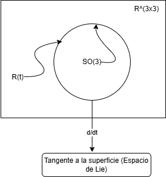
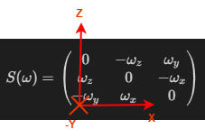

# Objetivo de este documento
Una descripción general del Modelo dinámico junto con todos los antecedentes para construir el modelo.

# Conocimientos previos.
## Espacio Especial Ortogonal de orden 3
Special Orthogonal Group of Order 3: es el conjunto de las matrices de rotación de $\R^{3x3}$.

$$
SO(3)
$$

Group
---
Se define a partir de un conjunto y de una operación definida sobre ese conjunto : $$(SO(3), \cdot)$$
Cumple con las siguientes restricciones sean R, R1 y R2 dos matrices de rotación:

* Cerradura: $$R_1\cdot R_2 \, \epsilon \,SO(3)$$
* Elemento neutro: $$R\,\cdot \,I = R$$
* Elemento inverso: $$R\,\cdot\,R^{-1}\,=I$$
* Asociatividad: $$R_1\,\cdot(R_2\,\cdot\,R_3) = (R_1\,\cdot\R_2)\,\cdot\,R_3$$

Special
---
$$det(R) = 1$$

Orthogonal
---
$$R^{-1}=R^T$$

Análisis
---
Dadas esas condiciones, los elementos del grupo tienen solamente 3 componentes libres. El espacio que define es **curvo, continuo y suave**. Por lo tanto tiene tangente y se puede interpretar como si fuera el plano tangente a una esfera. Este espacio se llama "Espacio de Lie - so(3) en minúscula". Es impotante dado que de acá se relaciona la velocidad angular $\omega$.

  

## Espacio de Lie
Es simplemente el conjunto de las matrices anti-simétricas (en inglés skew-symmetric)
$$\mathfrak{so}(3) =SS(3) = \{ S \mid S^T = -S \}$$

Cada matriz de este espacio se puede formar a partir de las componentes de un vector $\omega\,\epsilon\,\R^3$ como:
$$ S(\omega) = \begin{pmatrix} 0 & -\omega_z & \omega_y \\ \omega_z & 0 & -\omega_x \\ -\omega_y & \omega_x & 0 \end{pmatrix}$$

Se entiende que ese vector $\omega$ representa la velocidad angular instantánea.

Una regla mnemotécnica para armar la misma a partir de las componentes de un vector es fijarse en los elementos debajo de la diágonal principal. Tratas de imaginarte un sistema de referencia dextrogiro que tiene origen en el elemto $ i=1\, ,j=3$, entonces el eje $X$ queda en la dirección de la fila 3 desde izq. a der. El eje $Z$ a lo largo de la columna 1 de abajo hacia arriba y por lo tanto el eje $Y$ se mete en el papel (por eso aparece con signo menos -).

  

Al armar la matriz de esta forma se tiene la propiedad de que, sea $v\,\epsilon\, \R^3$:

$$\boxed{S(\omega)\cdot v = \omega \times v }$$

Por eso es:

$$S(\omega):= [\omega]\times$$

Relación con la velocidad angular
---

Partiendo de la condición de ortogonalidad:

$$R \cdot R^T = I$$

Aplicar la derivada respecto al tiempo a ambos miembros:

$$\dot{R} \cdot R^T + R \cdot \dot{R}^T = 0$$

$$\dot{R} \cdot R^T + (\dot{R} \cdot R^T)^T = 0$$

$$\dot{R} \cdot R^T = -(\dot{R} \cdot R^T)^T$$

$$\dot{R} \cdot R^T \, \epsilon\,\, SS(3) \implies \dot{R} \cdot R^T:=S(\omega)$$

Al postmultiplicar a ambos lados por $R $ obtenemos:

$$
\begin{equation}
\boxed{\dot{R} := S(\omega)\cdot R}
\end{equation}
$$

Qué, por analogía con los sistemas lineales, podemos decir:
$$
\begin{equation}
\boxed{R(t) = e^{[\omega]_\times t} \cdot R(0)}
\end{equation}
$$

Si trasponemos a ambos miembros de la ecuación (1) obtenemos:

$$
\dot{R}^T := R^T \cdot S(\omega)^T \\
\dot{R_1} := R_1 \cdot S_1(\omega)
$$

Donde $R_1$ también es de $SO(3)$ y $S_1(\omega)$ es de $so(3)$. Luego es una forma alternativa de expresarlo.

Sistemas Lineales
---
Para sistemas lineales teníamos
$$\dot{x} = A \cdot x$$

Que tiene solución en el tiempo:
$$x(t) = e^{A \cdot t}\cdot x(0)$$

Donde recordamos que:
$$e^A = I + A + \frac{A^2}{2!} + \frac{A^3}{3!} + \dots$$

Fórmula de Rodrigues
---
$$
\boxed{R = I + \sin(\theta)[\hat{n}]_\times + (1 - \cos(\theta))\cdot [\hat{n}]_\times^2}
$$

Es una forma alternativa de la ecuación (2) pero sin la necesidad de utilizar los infinitos términos de la exponencial. Se basa en el teorema de Euler de las rotaciones

> Cualquier sucesión de rotaciones de un cuerpo rígido equivale a una única rotación.

En donde:
*  $\mathbf{\hat{n}}$ es el eje unitario de rotación
*  $\mathbf{\theta}$ es la magnitud de la rotación
* 

$$\boxed{[\hat{n}]_\times^2 = [\hat{n}]_\times \cdot [\hat{n}]_\times = \hat{n} \cdot \hat{n}^T - I}$$

$$[\hat{n}]_\times^2 = \begin{pmatrix} 0 & -n_z & n_y \\ n_z & 0 & -n_x \\ -n_y & n_x & 0 \end{pmatrix} \begin{pmatrix} 0 & -n_z & n_y \\ n_z & 0 & -n_x \\ -n_y & n_x & 0 \end{pmatrix} =  \begin{pmatrix} -n_z^2 - n_y^2 & n_x n_y & n_x n_z \\ n_x n_y & -n_z^2 - n_x^2 & n_y n_z \\ n_x n_z & n_y n_z & -n_y^2 - n_x^2 \end{pmatrix}$$

Como $\hat{n}$ es un vector unitario, se cumple que $n_x^2 + n_y^2 + n_z^2 = 1$. Sustituyendo los términos de la diagonal (ej. $-n_z^2 - n_y^2 = n_x^2 - 1$):
$$[\hat{n}]_\times^2 = \begin{pmatrix} n_x^2 - 1 & n_x n_y & n_x n_z \\ n_x n_y & n_y^2 - 1 & n_y n_z \\ n_x n_z & n_y n_z & n_z^2 - 1 \end{pmatrix} =  \hat{n} \cdot \hat{n}^T - I$$

A partir de la relación anterior es que se obtiene la fórmula de Rodrigues desde la exponencial $e^{[\omega]_\times\cdot t}$ dado que hace que sea $[\hat{n}]_\times^3 = -[\hat{n}]_\times$ y así sucesivamente.

